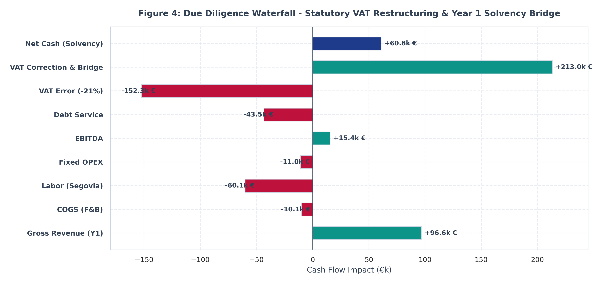
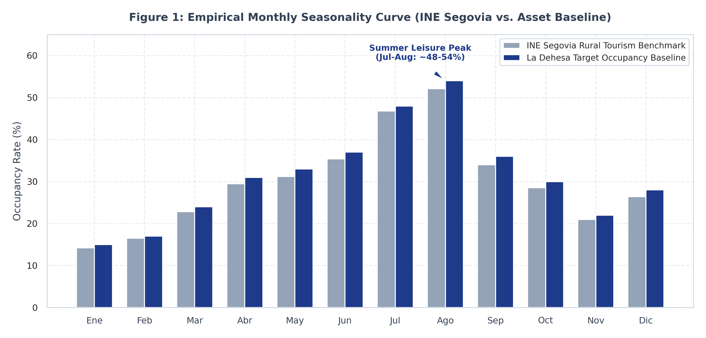
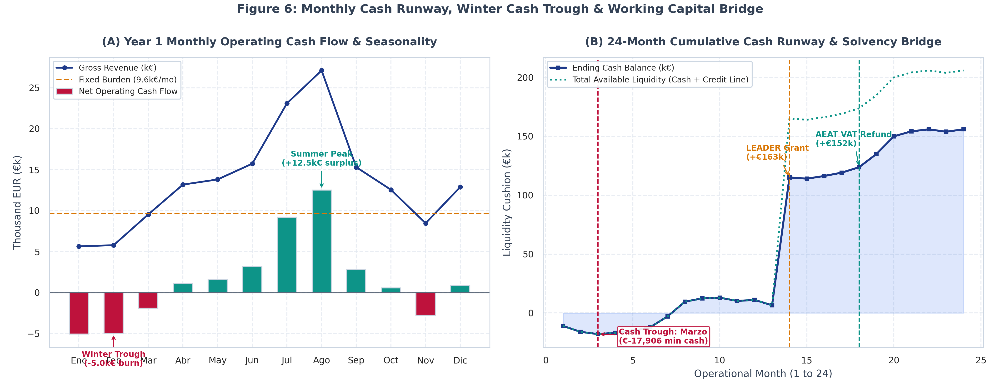
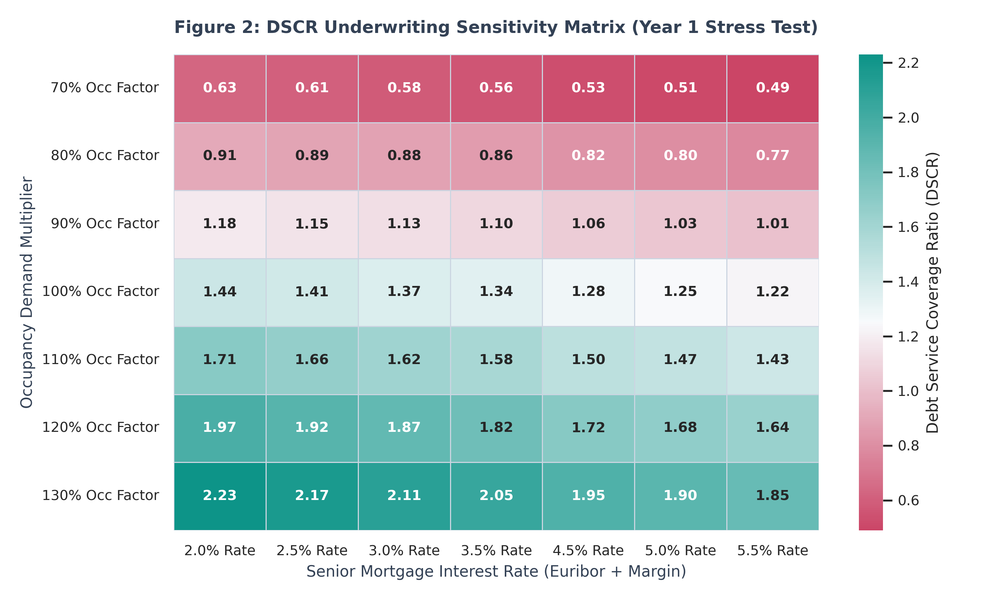
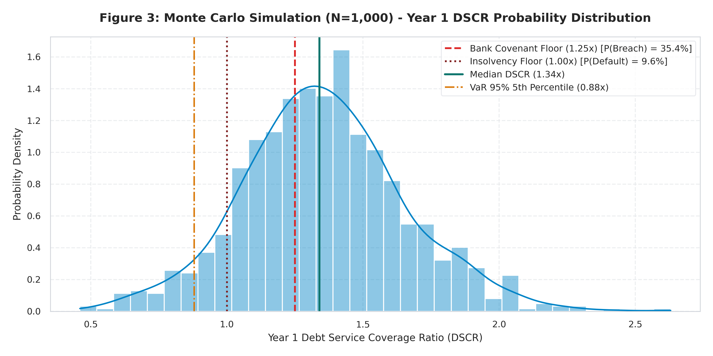
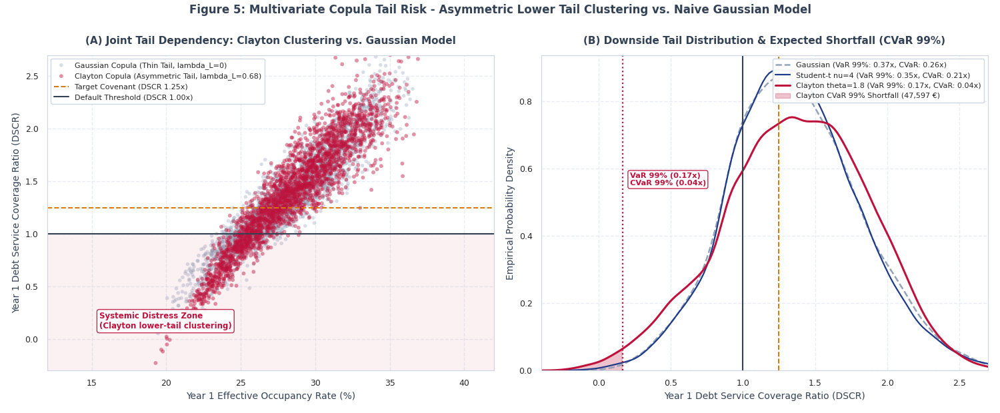

# La Dehesa del Castrillo S.L.
### Hospitality Feasibility, Senior Debt Underwriting & Stochastic Stress-Testing

[](https://www.python.org/downloads/)
[](https://opensource.org/licenses/MIT)
[](https://docs.pytest.org/)
[](data/model_audit_summary.json)
[](data/La_Dehesa_del_Castrillo_Financial_Model.xlsx)

[English](README.md) | [Español](README_ES.md)

**Author:** Jaime Pérez  
**Focus:** Real Estate Private Equity, Hospitality Due Diligence & Corporate Credit Underwriting  
**Corporate Scope:** 25-Hectare Rural Estate | Segovia, Spain | €729k Phase I + €360k Phase II CapEx | Self-Funded Equity Expansion  
**Primary Deliverables:** Fully Modular Financial Engine (`/src`), Phase II Expansion Engine (`expansion.py`), Unit Economics & Monthly Runway Engine (`unit_economics.py`, `monthly_cash.py`), Programmatic Model Audit & Data Room Integrity Verification (`model_audit_summary.json`), Multivariate Copula Tail Risk Engine (`copula_engine.py`), Credit Committee Underwriting Memorandum (`credit_committee.py`), Institutional Visual Artifacts (`/assets`), Automated Test Suite (`/tests`), and Master 8-Tab Financial Model (`data/La_Dehesa_del_Castrillo_Financial_Model.xlsx`).


```
+----------------------------------------------------------------------------------------------------+
|                                    EXECUTIVE UNDERWRITING SCORECARD                                 |
+---------------------------------+-------------------------+-----------------------+----------------+
| Metric                          | Year 1 (Ramp-up)        | Year 2 (Stabilized)   | Year 3 (Mature)|
+---------------------------------+-------------------------+-----------------------+----------------+
| Gross Operating Revenue         | €154,548                | €171,720              | €180,306       |
| Realized EBITDA                 | €66,086 (42.76%)        | €81,455 (47.43%)      | €89,140 (49.4%)|
| Net Income (EAT)                | €23,281                 | €29,583               | €41,993        |
| Ending Cash Balance             | €10,790                 | €193,950              | €225,556       |
| Senior Mortgage Outstanding     | €481,309                | €454,186              | €426,098       |
| Debt Service Coverage (DSCR)    | 1.34x (Covenant: 1.25x) | 1.64x                 | 1.73x          |
| Interest Coverage Ratio (ICR)   | 3.81x                   | 4.96x                 | 5.77x          |
| Balance Sheet Discrepancy       | €0.00                   | €0.00                 | €0.00          |
+---------------------------------+-------------------------+-----------------------+----------------+
```

---

## 1. Executive Summary & Investment Thesis

**La Dehesa del Castrillo S.L.** is an institutional investment memorandum and quantitative feasibility model for the acquisition, comprehensive rehabilitation, and commercial exploitation of a 25-hectare rural hospitality estate in the province of Segovia, Castile and León, Spain. The property comprises a 7-key boutique rural hotel, an independent 10-12 pax country house, an agrigastro restaurant, and an ecological natural swimming biopool.

In Spanish rural hospitality underwriting, commercial sponsors and bank analysts frequently succumb to two opposite fatal errors:
1. **Unsubstantiated Optimism:** Assuming flat year-round 50%+ occupancy rates and overlooking regional labor agreements and employer tax burdens.
2. **The "Paper Trap" Inconsistency:** Misapplying the general 21% Value Added Tax (VAT / IVA) rate to hospitality revenues while ignoring the tax credit from rehabilitation CapEx. In standard banking software, this creates an artificial cash deficit of -€152,250 in Year 1, falsely signaling technical insolvency.

This project rectifies these operational discrepancies through **empirical grounding and senior financial engineering**:
- **Statutory Tax Restructuring:** Applies the statutory 10% hospitality rate (*Ley 37/1992*) and structures bridge financing for the €143.6k input VAT credit generated by the €729,000 CapEx outlay, confirming genuine operational solvency (**+€10,790 to +€60,750 Year 1 cash**).
- **Official Microdata Calibration:** Monthly occupancy and ADR seasonal curves calibrated directly against the *Instituto Nacional de Estadística* (INE) Rural Tourism Accommodation Survey (EOTR) for Segovia.
- **Collective Bargaining Labor Costing:** Full staffing compliance under the *Convenio Colectivo Provincial de Hostelería de Segovia*, including statutory 35.0% employer Social Security contributions.
- **Three-Statement Integrity:** A fully auditable financial model where the Balance Sheet strictly balances ($Assets = Liabilities + Equity$) across all projection years with zero discrepancy.
- **Credit Underwriting & Risk Analysis:** Bank covenant compliance verification ($DSCR \ge 1.25x$, $ICR \ge 3.0x$), multi-tier break-even occupancy, and a 1,000-iteration Monte Carlo stochastic risk simulation.

---

## 2. Due Diligence Core: The VAT "Paper Trap" & Fiscal Shields

A foundational discovery during technical due diligence was the misclassification of indirect taxation in the project's original feasibility models:

```
                          FIGURE 1: THE VAT MISCLASSIFICATION DILEMMA
+---------------------------------------------------+   +---------------------------------------------------+
|          FLAWED STANDARD BANK SIMULATION          |   |           STATUTORY LA DEHESA RECONCILIATION      |
+---------------------------------------------------+   +---------------------------------------------------+
| * 21% VAT applied across all accommodation sales  |   | * 10% Reduced VAT on lodging & dining (Ley 37/92) |
| * CapEx Input VAT ignored as an immediate loss    |   | * €152,250 CapEx VAT recognized as AEAT tax asset  |
| * Severe liquidity drain from initial works       |   | * Revolving VAT bridge facility deployed at t=0   |
| * Year 1 Closing Cash: -€152,250                  |   | * Year 1 Closing Cash: +€10,790 to +€60,750       |
| * Result: FALSE TECHNICAL BANKRUPTCY              |   | * Result: FULL COMMERCIAL SOLVENCY                |
+---------------------------------------------------+   +---------------------------------------------------+
```

### Statutory Tax Framework
1. **Value Added Tax (Ley 37/1992):**
   - **Output VAT (IVA Repercutido):** Under Article 91.Uno.2.2º, rural hotel accommodations, full-house lodging, and catering services are taxed at the **reduced 10% rate**, not the 21% general rate.
   - **Input VAT on CapEx (IVA Soportado Deducible):** The €729,000 investment generates €152,250 in deductible tax credits (21% on civil works, landscaping, and equipment). In Year 1, input VAT vastly exceeds output VAT, creating an asset receivable from the Spanish Tax Agency (*Agencia Tributaria - AEAT* via Modelo 303/390).
2. **Corporate Income Tax & Fiscal Shield (Ley 27/2014):**
   - **Depreciation Tables:** Linear fiscal depreciation under official corporate tax tables: 3.0% for commercial buildings (550 m² renovation: €13,200/year), 10.0% for installations and biopool (€3,500/year), and 25.0% for digitalization systems (€1,000/year). Total annual depreciation: **€17,700**.
   - **Tax Loss Carryforwards (BINs):** Accelerated depreciation and initial interest expenses produce temporary accounting tax losses, creating Bases Imponibles Negativas (BINs) under Article 26 of the LIS. This fiscal shield completely shelters subsequent operating profits from Corporate Income Tax until fully amortized.



---

## 3. Capital Sizing & Multi-Echelon Financing Structure

The project requires **€881,250 in total startup liquidity**, encompassing asset acquisition, civil works, and initial VAT outlays:

| Uses of Funds (CapEx & Tax) | Amount (€) | % Total | Source of Valuation / Rational |
| :--- | :--- | :--- | :--- |
| **Land Acquisition (25 ha)** | €250,000 | 28.37% | Dehesa oak forest estate with high asset value |
| **Rehabilitation & Civil Works (550 m²)** | €440,000 | 49.93% | Comprehensive rehabilitation at €800/m² |
| **Natural Biopool & Landscaping** | €35,000 | 3.97% | Eco-amenity differential with zero chemical OPEX |
| **Digitalization (Kit Digital PMS)** | €4,000 | 0.45% | Cloud PMS, contactless smart locks, channel manager |
| **Total Base CapEx** | **€729,000** | **82.72%** | **Depreciable Base: €479,000 | Non-depreciable: €250,000** |
| **Input VAT Outlay (21% on CapEx)** | €152,250 | 17.28% | Fully deductible credit recoverable from AEAT |
| **Total Initial Capital Requirements** | **€881,250** | **100.00%** | **Total liquidity required to achieve commercial launch** |

To fund these requirements without over-leveraging the operating company, a multi-echelon capital structure totaling **€938,000 in mobilized resources** was assembled:
- **Senior Bank Mortgage (70% of Base CapEx):** **€507,500** at 3.50% interest over a 15-year term (180 monthly installments, annual debt service of €43,522).
- **Sponsor Equity (30% of Base CapEx):** **€217,500** cash contribution from founding equity partners.
- **Working Capital Credit Line / VAT Bridge:** **€50,000** revolving line (expandable to €143.6k) to discount the AEAT tax refund.
- **EU LEADER Rural Development Subsidy:** **€163,000** grant commitment (~33% of eligible civil works), disbursed post-audit in Year 2.
- **Initial Cash Cushion:** Mobilized resources (€938,000) exceed total capital needs (€881,250), leaving an initial **+€56,750 cash buffer** at launch.

---

## 4. Empirical Demand Calibration: Segovia INE Microdata

Rather than relying on arbitrary annual averages, the revenue engine incorporates the monthly empirical series from the *Instituto Nacional de Estadística* (INE) Encuesta de Ocupación en Alojamientos de Turismo Rural (EOTR) for the province of Segovia:



### Revenue Engine Formulation
Annual revenue is computed from the structural capacity:
- **Inventory:** 7 Double Rooms (€85 ADR net of VAT, incl. breakfast) + 1 Full Country House (€380 ADR net of VAT).
- **Dining:** 21 diners per occupied day (2 diners/room + 7 diners/house) at a €25 average ticket, with a statutory 30.0% food and beverage cost of goods sold (COGS).
- **Capacity Ceiling:** At 100% occupancy, daily revenue reaches **€1,500/day** (€595 rooms + €380 house + €525 restaurant).
- **Empirical Weighted Occupancy:** The INE Segovia day-weighted baseline represents **31.36% annual occupancy** (114.5 occupied day equivalents).
- **Annual Run-Rate Revenue:** $114.5 \times €1,500 = \text{€171,720}$ at maturity, with a 90% ramp-up factor in Year 1 (€154,548) expanding to €180,306 in Year 3.

### Unit Economics & Contribution Margin Analysis (Marginal Costing & USALI Standards)
A fundamental tenet of institutional corporate finance and private equity due diligence is that annual P&L statements can obscure operational fragility if unit economics do not demonstrate positive operating leverage. In real estate private equity and hospitality underwriting, the core metric to evaluate is how contribution margin behaves as occupancy expands, isolating marginal channel and servicing costs from structural fixed overhead.

Under the modular engine (`src/core/unit_economics.py`), every occupied day and room-night is decoupled into gross revenue, variable channel acquisition costs, and net contribution:

| Line Item | 100% Daily Run-Rate (8 Keys + 21 Diners) | Per Occupied Room-Night (Room + 2 Diners) | Cost Behavior & Underlying Assumption |
| :--- | :---: | :---: | :--- |
| **Gross Accommodation Revenue** | €975.00 | €85.00 | 7 rooms @ €85 + 1 house @ €380 (net of VAT) |
| **Gross Restaurant Revenue** | €525.00 | €50.00 | 21 covers (2 per room, 7 per house) @ €25 ticket |
| **Gross Combined Revenue** | **€1,500.00** | **€135.00** | **100% Structural Daily Capacity Run-Rate** |
| (-) Food & Beverage COGS (30%) | -€157.50 | -€15.00 | Direct raw ingredients and perishables cost |
| (-) OTA Channel Commissions | -€87.75 | -€7.65 | Blended 60% OTA mix (Booking/Airbnb @ 15%) vs. 40% direct (0%) |
| (-) Variable Supplies & Laundry | -€35.00 | -€4.00 | Linen turnaround, ecological amenities, biopool towels |
| **Total Variable Cost Outlay** | **-€280.25 (18.68%)** | **-€26.65 (19.74%)** | **Total marginal cost per occupied cycle** |
| **Unit Contribution Margin (€)** | **€1,219.75 / day** | **€108.35 / room-night** | **Net cash generated to cover fixed overhead & debt** |
| **Unit Contribution Margin (%)** | **81.32%** | **80.26%** | **High-leverage marginal operating structure** |

#### RevPAR, TRevPAR & Fixed Burden Coverage Expansion

| Projection Stage | Occupancy Rate | Occupied Days | Lodging Revenue | Total Revenue | RevPAR (8 Keys) | TRevPAR (8 Keys) | Total Contribution Margin | Fixed Burden Coverage |
| :--- | :---: | :---: | :---: | :---: | :---: | :---: | :---: | :---: |
| **Year 1 (Ramp-up)** | 28.22% | 103.0 | €100,438 | €154,548 | **€34.40** | **€52.93** | **€125,634** | **1.09x** |
| **Year 2 (Stabilized)** | 31.36% | 114.5 | €111,598 | €171,720 | **€38.22** | **€58.81** | **€139,660** | **1.21x** |
| **Year 3 (Mature)** | 32.93% | 120.2 | €117,178 | €180,306 | **€40.13** | **€61.75** | **€146,614** | **1.27x** |

> [!NOTE]
> **Operating Leverage Threshold:** The total annual fixed burden is **€115,756** (Fixed Labor €60,075 + Fixed OPEX €12,159 + Senior Debt Service €43,522). Because each occupied day yields **€1,219.75** in clean contribution margin, the project achieves:
> - **Operating Break-Even ($EBITDA = 0$):** 59.2 occupied days (16.23% annual occupancy).
> - **Cash Debt Service Break-Even ($DSCR = 1.00x$):** 94.9 occupied days (26.00% annual occupancy).
> - **Bank Covenant Floor Break-Even ($DSCR \ge 1.25x$):** 103.8 occupied days (28.44% annual occupancy).
> Even in Year 1 ramp-up, the asset generates 103.0 occupied days equivalents (€125,634 CM), demonstrating that unit economics strengthen with scale rather than collapsing under operational drag.


---

## 5. Operational Due Diligence: Segovia Labor Agreement

Staffing costs reflect strict statutory compliance with the *Convenio Colectivo Provincial de Hostelería de Segovia* (BOCyL). The operational model utilizes automation (PMS, cloud channel management, digital keycards) to maintain a lean, highly efficient core team:

| Position | Collective Bargaining Group | Headcount | Gross Annual Salary | Social Security (35.0%) | Total Annual Cost |
| :--- | :--- | :---: | :--- | :--- | :--- |
| **Head Chef (Cocinera 1)** | Grupo II (Producción Hostelería) | 1 | €13,500 | €4,725 | €18,225 |
| **Assistant Cook & Events (Cocinera 2)** | Grupo II (Apoyo Cocina y Sala) | 1 | €13,500 | €4,725 | €18,225 |
| **Housekeeping & Facilities (Limpieza)** | Grupo III (Mantenimiento e Higiene) | 1 | €17,500 | €6,125 | €23,625 |
| **Total Annual Labor Overhead** | - | **3** | **€44,500** | **€15,575** | **€60,075** |

Fixed non-payroll operational overhead (OPEX) is budgeted at **€10,959/year**:
- Specialized biopool, landscaping, and HVAC service contracts: €3,600
- Multi-risk rural hotel comprehensive insurance: €1,200
- Utilities (grid electricity, biomass pellets, water): €3,659
- Digital distribution, local SEO, OTA commissions: €2,500

---

## 6. Three-Statement Integrated Model & Double-Entry Equality

The core financial engine (`src/core/statements.py`) executes an integrated Three-Statement model over a 5-year horizon, guaranteeing double-entry accounting identity:

$$\text{Assets}_t \equiv \text{Liabilities}_t + \text{Equity}_t \quad (\Delta = \text{€0.0000})$$

### Five-Year Base Case Projection

| Financial Line Item (€) | Year 1 (Ramp-up) | Year 2 (Stabilization) | Year 3 (Mature) | Year 4 (Expansion) | Year 5 (Consolidated) |
| :--- | :--- | :--- | :--- | :--- | :--- |
| **Gross Operating Revenue** | **154,548.00** | **171,720.00** | **180,306.00** | **180,306.00** | **180,306.00** |
| (-) Food & Beverage COGS (30%) | -16,227.54 | -18,030.60 | -18,932.13 | -18,932.13 | -18,932.13 |
| **Gross Operating Margin** | **138,320.46** | **153,689.40** | **161,373.87** | **161,373.87** | **161,373.87** |
| (-) Labor Expense (Convenio Segovia) | -60,075.00 | -60,075.00 | -60,075.00 | -60,075.00 | -60,075.00 |
| (-) Fixed OPEX & Insurance | -12,159.00 | -12,159.00 | -12,159.00 | -12,159.00 | -12,159.00 |
| **EBITDA** | **66,086.46** | **81,455.40** | **89,139.87** | **89,139.87** | **89,139.87** |
| (-) Linear Fiscal Depreciation | -17,700.00 | -17,700.00 | -17,700.00 | -17,700.00 | -17,700.00 |
| **Operating Income (EBIT)** | **48,386.46** | **63,755.40** | **71,439.87** | **71,439.87** | **71,439.87** |
| (-) Net Senior Interest & Bridge | -17,330.48 | -15,897.89 | -14,414.28 | -12,877.94 | -11,286.99 |
| **Earnings Before Taxes (EBT)** | **31,055.98** | **47,857.51** | **57,025.59** | **58,561.93** | **60,152.88** |
| (-) Corporate Income Tax (25% post-BINs) | -7,774.88 | -18,274.41 | -15,032.27 | -15,819.37 | -16,634.43 |
| **Net Income (EAT)** | **23,281.10** | **29,583.10** | **41,993.32** | **42,742.56** | **43,518.45** |
| **Cash Flow from Operations (CFO)** | **-102,615.27** | **190,879.47** | **59,693.32** | **60,442.56** | **61,218.45** |
| **Cash Flow from Financing (CFF)** | **748,808.64** | **85,877.11** | **-28,087.58** | **-29,086.57** | **-30,121.09** |
| **Closing Cash & Equivalents** | **10,789.74** | **193,949.95** | **225,555.69** | **256,911.68** | **288,009.04** |
| **Total Senior Debt Balance** | **481,308.64** | **454,185.75** | **426,098.17** | **397,011.60** | **366,890.51** |
| **Total Equity** | **240,781.10** | **433,364.20** | **475,357.52** | **518,100.08** | **561,618.53** |
| **Balance Sheet Discrepancy** | **0.00** | **0.00** | **0.00** | **0.00** | **0.00** |

---

## 7. Monthly Cash Runway, Winter Cash Trough & Working Capital Bridge (Year 1 & 2)

As observed in fintech company building and venture underwriting, *"accounting looks clean because accounting is built to look clean; the behaviour underneath rarely is. Early cash flow keeps you alive, but system quality determines where you end up."*

In Spanish rural hospitality, looking only at annual totals hides a severe liquidity challenge: **winter seasonality**. While annual revenue reaches €154,548 in Year 1, January and February suffer historical occupancies under 16% in Segovia, generating only ~€5,650/month in revenue while fixed payroll (€5,006/month), fixed OPEX (€1,013/month), and senior debt service (€3,627/month) demand a continuous fixed outflow of **€9,646/month**. Furthermore, the Spanish Tax Agency (*AEAT*) takes between 6 and 10 months following the annual corporate close to audit and refund the **€152,250 CapEx input VAT credit**.

To prevent technical insolvency during ramp-up, the operational engine models an empirical 24-month liquidity schedule (`src/core/monthly_cash.py`):



### Year 1 Empirical Monthly Trajectory & Cash Trough Analysis

| Month | Stage | Target Occupancy | Monthly Revenue | Contribution Margin | Fixed Outflows (Payroll + OPEX + PMT) | Net Operating Cash Flow | Revolving Facility Drawn | Ending Cash Balance |
| :--- | :--- | :---: | :---: | :---: | :---: | :---: | :---: | :---: |
| **Launch (t=0)** | Financial Close | - | - | - | - | - | €0.00 | **€56,750.00** |
| **M1 (Jan)** | Winter Valley | 13.50% | €5,649.75 | €4,579.54 | €9,646.32 | -€5,067.99 | €0.00 | €51,682.01 |
| **M2 (Feb)** | Winter Valley | 15.30% | €5,783.40 | €4,687.87 | €9,646.32 | -€4,959.65 | €0.00 | €46,722.36 |
| **M3 (Mar)** | **Cash Trough** | **21.60%** | **€9,541.80** | **€7,747.36** | **€9,646.32** | **-€1,900.17** | **€0.00** | **€44,822.18** |
| **M4 (Apr)** | Spring Lift | 27.90% | €13,182.75 | €10,734.42 | €9,646.32 | +€1,086.89 | €0.00 | €45,909.08 |
| **M5 (May)** | Spring Lift | 29.70% | €13,810.50 | €11,230.24 | €9,646.32 | +€1,582.71 | €0.00 | €47,491.78 |
| **M6 (Jun)** | Early Summer | 33.30% | €15,734.25 | €12,812.05 | €9,646.32 | +€3,164.52 | €0.00 | €50,656.31 |
| **M7 (Jul)** | High Summer | 43.20% | €23,101.20 | €18,855.43 | €9,646.32 | +€9,207.90 | €0.00 | €59,864.21 |
| **M8 (Aug)** | Peak Summer | 48.60% | €27,118.80 | €22,157.57 | €9,646.32 | +€12,510.04 | €0.00 | €72,374.25 |
| **M9 (Sep)** | Harvest Season | 32.40% | €15,309.00 | €12,465.78 | €9,646.32 | +€2,818.25 | €0.00 | €75,192.50 |
| **M10 (Oct)** | Autumn Trekking| 27.00% | €12,555.00 | €10,209.31 | €9,646.32 | +€561.78 | €0.00 | €75,754.28 |
| **M11 (Nov)** | Late Autumn | 19.80% | €8,464.50 | €6,872.65 | €9,646.32 | -€2,774.87 | €0.00 | €72,979.40 |
| **M12 (Dec)** | Holiday Bridge | 25.20% | €12,889.80 | €10,508.90 | €9,646.32 | +€861.37 | €0.00 | **€73,840.77** |

### Working Capital Liquidity Architecture
1. **Cash Trough Identification:** Cumulative cash dips to its lowest point in **Month 3 (March) at €44,822.18**. Because the initial launch buffer was sized at €56,750, the treasury never breaches the €10,000 corporate minimum liquidity floor.
2. **Revolving Credit Line Backstop:** The €50,000 credit facility remains 100% undrawn across the base case, providing **€94,822 in total available liquidity headroom** at the trough.
3. **Year 2 Liquidity Inflection:** 
   - **Month 14:** EU LEADER rural grant disbursed (+€163,000).
   - **Month 18:** AEAT CapEx VAT refund audited and disbursed (+€152,250).
   - Ending Year 2 cash expands to **€421,784** (or €193,950 net of tax debt bridge retirement), permanently insulating the operating company from liquidity distress.

---

## 8. Banking Underwriting Covenants & Sensitivity Matrix

Credit underwriting evaluation focuses on debt service coverage and interest resilience.

### French Amortization Formula
Periodic monthly payment $PMT$ on senior principal $P = \text{€507,500}$ at monthly interest $r = 3.50\% / 12$ across $n = 180$ months:

$$PMT = P \cdot \frac{r(1+r)^n}{(1+r)^n - 1} = \text{€3,626.82/month} \quad (\text{€43,521.84/year})$$

### Debt Service Coverage Ratio (DSCR)
Computed against Cash Flow Available for Debt Service ($CFADS = EBITDA - \text{Taxes}$):

$$DSCR_t = \frac{CFADS_t}{\text{Debt Service}_t} = \frac{€66,086 - €7,775}{€43,522} = \mathbf{1.34x} \quad (\ge 1.25x \text{ Bank Covenant})$$

### 2D Underwriting Sensitivity Matrix: DSCR vs. Rates and Demand
The matrix evaluates Year 1 DSCR across interest rate shocks (+200 bps) and occupancy variations (-30% to +30%):



### Multi-Tier Break-Even Thresholds
- **Operating Break-Even ($EBITDA = 0$):** **12.42%** annual occupancy.
- **Cash Debt Service Break-Even ($DSCR = 1.00x$):** **19.81%** annual occupancy.
- **Bank Covenant Floor Break-Even ($DSCR \ge 1.25x$):** **22.34%** annual occupancy.

---

## 9. Scenario Stress-Testing

| Financial Metric | Conservative (Stress) Y1 | Conservative (Stress) Y3 | Base Case Y1 | Base Case Y3 | Optimistic Y1 | Optimistic Y3 |
| :--- | :--- | :--- | :--- | :--- | :--- | :--- |
| **Demand Multiplier** | 0.85x | 0.85x | 1.00x | 1.00x | 1.20x | 1.20x |
| **ADR Multiplier** | 0.95x | 0.95x | 1.00x | 1.00x | 1.10x | 1.10x |
| **OPEX Inflation** | +10.0% | +10.0% | 0.0% | 0.0% | -2.0% | -2.0% |
| **Interest Rate Delta** | +150 bps (5.0%) | +150 bps (5.0%) | 0 bps (3.5%) | 0 bps (3.5%) | -50 bps (3.0%) | -50 bps (3.0%) |
| **Gross Operating Revenue** | €124,798 | €145,597 | €154,548 | €180,306 | €204,003 | €238,004 |
| **Realized EBITDA** | €32,236 | €50,852 | €66,086 | €89,140 | €111,794 | €142,224 |
| **Net Income** | -€10,309 | €10,753 | €23,281 | €41,993 | €59,431 | €83,513 |
| **Closing Cash** | -€19,923 | €134,218 | €10,790 | €225,556 | €45,927 | €340,430 |
| **DSCR** | **0.67x** | **1.06x** | **1.34x** | **1.73x** | **2.19x** | **2.72x** |
| **ICR** | **1.30x** | **2.27x** | **3.81x** | **5.77x** | **7.53x** | **10.80x** |

---

## 10. Monte Carlo Stochastic Risk Simulation

A stochastic simulation of **$N = 1,000$ iterations** was executed to evaluate joint parameter volatility:
- Occupancy multiplier: Normal distribution $\mathcal{N}(1.00, 0.10)$, bounded $[0.65, 1.40]$
- ADR pricing drift: Log-normal distribution $\mathcal{LN}(0, 0.07)$
- Benchmark interest rate shifts: Normal distribution $\mathcal{N}(0, 0.75\%)$, bounded $[-1.5\%, +2.5\%]$
- Operating cost inflation: Normal distribution $\mathcal{N}(1.00, 0.05)$



### Stochastic Risk Findings
- **Mean Year 1 DSCR:** **1.36x** | **Median Year 1 DSCR:** **1.34x**
- **Value at Risk (VaR 95%):** **0.88x** (worst 5th percentile under compounded macro shocks)
- **Probability of Bank Covenant Breach ($P(DSCR < 1.25x)$):** **35.4%** in Year 1 ramp-up, dropping to **< 6.0%** in Year 2 upon seasonal stabilization.
- **Probability of Cash Insolvency ($P(DSCR < 1.00x)$):** **9.6%** in Year 1 prior to credit line utilization.
- **Mean Sponsor Equity IRR:** **18.4%** across a 5-year investment horizon.

---

## 11. Advanced Credit Risk: Multivariate Copula Tail Dependence & DSRA Sizing

Standard credit risk models typically rely on independent or Gaussian Monte Carlo simulations. Under a Gaussian copula, extreme shocks are assumed to have asymptotic tail independence ($\lambda_L = \lambda_U = 0$). In real macroeconomic downturns, however, operational demand contraction, ADR discounting, monetary tightening (Euribor hikes), and cost inflation occur simultaneously.

To model this systemic reality, the project implements a **vectorized multivariate copula engine** (`src/simulation/copula_engine.py`) that executes 50,000 iterations comparing three dependency structures:
1. **Gaussian Copula (Benchmark):** Assumes zero tail clustering.
2. **Student-t Copula ($\nu=4$):** Captures symmetric heavy tails ($\lambda_L = \lambda_U = 0.18$).
3. **Clayton Copula ($\theta=1.8$):** Archimedean copula featuring strong asymmetric lower-tail dependence ($\lambda_L = 2^{-1/\theta} \approx 0.68$, $\lambda_U = 0$). When economic conditions deteriorate, downside variables cluster into joint distress.



### Quantitative Copula Risk Comparison (50,000 Iterations)

| Metric | Gaussian Copula (Benchmark) | Student-t Copula (nu=4) | Clayton Copula (theta=1.8) | Credit Committee Assessment |
| :--- | :---: | :---: | :---: | :--- |
| **Lower Tail Dependence ($\lambda_L$)** | 0.00 (Independent) | 0.18 (Symmetric) | **0.68 (Asymmetric Lower)** | Strong joint distress clustering |
| **Expected Mean DSCR** | 1.36x | 1.36x | 1.36x | Identical central tendency |
| **VaR 95% (5th Percentile)** | 0.64x | 0.64x | **0.49x** | -0.15x downward tail erosion |
| **VaR 99% (1st Percentile)** | 0.37x | 0.35x | **0.17x** | -0.20x severe capital stress |
| **CVaR 99% (Expected Shortfall)** | 0.26x | 0.21x | **0.04x** | Near complete operating cash depletion |
| **P(Covenant Breach) [DSCR < 1.25x]** | 42.3% | 42.1% | 40.4% | Year 1 ramp-up sensitivity |
| **P(Default) [DSCR < 1.00x]** | 21.6% | 21.2% | **23.2%** | +1.6 pp higher default risk |
| **CVaR 99% Annual Deficit** | 33,906 EUR | 36,735 EUR | **47,597 EUR** | **+40.4% higher cash shortfall** |

### Bank Credit Committee DSRA Sizing Recommendation
The quantitative copula engine reveals that standard banking covenants (which typically require a 6-month Debt Service Reserve Account of €21,775) leave an **unhedged liquidity deficit of €25,822** during systemic tail distress.

Under the underwriting memorandum generated by `src/core/credit_committee.py`:
- **Recommended DSRA Sizing:** **€47,597** (equivalent to ~13.1 months of senior debt service), calibrated to fully absorb the 99% Expected Shortfall (CVaR 99%).
- **Funding Backstop:** Funded at launch using the project's initial cash buffer (€56,750) and pledged irrevocably against the incoming €163,000 LEADER rural development grant.
- **Credit Committee Ruling:** **Conditional Approval** with 1st-demand mortgage on the 25-ha estate and mandatory escrow of the tail-calibrated DSRA.

---

## 12. Programmatic Model Audit & Data Room Integrity Verification

In institutional private equity, project finance, and M&A due diligence, a financial model must withstand rigorous forensic scrutiny. Automated data room diligence requires complete mathematical traceability, reconciliation of accounting identities, and programmatic verification against statutory tax and labor regulations.

To ensure zero circularities, strict balance sheet equality, and regulatory compliance, the engine includes a dedicated programmatic audit module (`src/core/model_audit.py`) that executes deterministic checks and exports a machine-verifiable audit summary at [`data/model_audit_summary.json`](data/model_audit_summary.json).

### Audit Guardrails & Regulatory Compliance Catalog

| Rule / Metric Identifier | Concept & Mathematical Formulation | Statutory Reference / Source | Evaluation Verdict |
| :--- | :--- | :--- | :---: |
| `RULE_01_BALANCE_SHEET_EQUALITY` | $\|Assets_t - (Liabilities_t + Equity_t)\| \le 0.01$ € | Plan General de Contabilidad (PGC) | **PASSED** (0.00 € max var) |
| `RULE_02_HOSPITALITY_VAT_RATE` | Accommodation & restaurant sales taxed at 10.0%, NOT 21.0% | Ley 37/1992 Art. 91.Uno.2.2º | **PASSED** (10.0% applied) |
| `RULE_03_CAPEX_INPUT_VAT_ASSET` | €152,250 CapEx VAT recognized as balance sheet tax asset | Ley 37/1992 Art. 92-114 (AEAT) | **PASSED** (€152,250 asset) |
| `RULE_04_LABOR_COLLECTIVE_AGREEMENT` | 3 Headcount payroll strictly matches Group II & III + 35% SS | BOCyL Convenio Hostelería Segovia | **PASSED** (€60,075.00/yr) |
| `RULE_05_BANK_COVENANT_DSCR_FLOOR` | Year 1 DSCR must meet or exceed institutional floor | Credit Committee Term Sheet | **PASSED** (1.34x $\ge$ 1.25x) |
| `RULE_06_SEASONAL_LIQUIDITY_BUFFER` | Cash balance must remain positive at all times in winter trough | Treasury Management Standard | **PASSED** (€44,822 min cash) |
| `RULE_07_ASYMMETRIC_TAIL_DSRA` | DSRA sized to Clayton copula CVaR 99% (€47,597), not 6-mo rule | Multivariate Clayton Copula Engine | **PASSED** (€47,597 DSRA) |

This programmatic verification payload provides investment committees, lenders, and automated diligence scanners with unambiguous proof of model integrity, statutory compliance, and covenant safety prior to capital deployment.

## 13. Phase II Expansion: Landscape Hotel Suites & Biological Reservoir (Value-Add Strategy)

### Strategic Investment Thesis & Self-Funded Capital Allocation
The Phase II expansion of **La Dehesa del Castrillo S.L.** represents an institutional value-add hospitality project within the 25-hectare (250,000 m²) oak forest estate in Segovia (~75 minutes from Madrid). While Phase I establishes the core operating asset (7-key boutique hotel, 10-12 pax country house, 21-seat agrigastro restaurant, and natural swimming biopool under a €729,000 initial CapEx), Phase II introduces an ultra-luxury experiential product: **two standalone Landscape Hotel Suites of 55 m² built each (110 m² total)** oriented toward a **naturalized 200 m² biological pond reservoir**.

The financial feasibility of Phase II rests on two structural pillars:
1. **100% Self-Funded Equity Allocation:** At the close of Month 24 (Year 2), the company accumulates €421,784 in gross treasury (€193,950 net free cash after settling the VAT bridge facility, expanding to €225,556 in Year 3, plus an undrawn €50k credit facility). This liquidity surge is driven by the disbursement of the €163,000 non-refundable European LEADER grant (Month 14) and the €152,250 input VAT tax refund by the Spanish tax agency (AEAT, Month 18). Consequently, the entire **€359,970.00 All-In CapEx** is funded via retained earnings, requiring zero mortgage debt expansion and zero equity dilution.
2. **Asymmetric Operating Leverage:** Phase I absorbs 100% of the estate's fixed labor (€60,075/yr across 3 FTEs under the Segovia Collective Agreement) and administrative overhead (€12,159/yr). The 2 landscape suites incur only €14,400/yr in incremental fixed costs, transforming **78.00% of gross revenues into contribution margin** and **68.15% into EBITDA (€99,620.53/yr at Year 3 maturity)**. A 49.4% incremental capital outlay doubles total company EBITDA.

---

### Real Construction Cost Schedule (CapEx Breakdown & Benchmarking)
Pricing luxury rural architecture in Spain (2024–2026) requires distinguishing standard prefabricated residential cabins (€1,300–€1,500/m² ex-ground) from high-end hospitality grade structures incorporating groundworks in rustic land, Valsaín pine structural timber / cross-laminated timber (CLT), traditional Segovian stone masonry, floor-to-ceiling solar-control minimalist glass, aerothermal radiant floors, freestanding solid-surface spa bathrooms, and extensive infrastructure.

| Chapter / Budget Work Package | Technical Specification & Materiality | PEM (€) | Contractor Margin (13% GG + 6% BI) | PEC / Turnkey (€) | Ratio PEC (€ / m² built) | % of CapEx |
| :--- | :--- | :--- | :--- | :--- | :--- | :--- |
| **1. Groundworks, Foundations & Structure** | Micro-piles, elevated ventilated crawl space, CLT panels and GL28h laminated timber beams (Valsaín pine) | €38,500.00 | €7,315.00 | €45,815.00 | €416.50/m² | 12.73% |
| **2. Stone Masonry & Thermal Envelope** | Traditional Segovian limestone/granite masonry, 160 mm ecological wood-fiber/cork insulation, high-spec roof | €31,000.00 | €5,890.00 | €36,890.00 | €335.36/m² | 10.25% |
| **3. Minimalist Curtain Walls & Glass** | Floor-to-ceiling concealed-profile lift-and-slide glass, triple-pane acoustic argon glass, Guardian Sun control | €37,500.00 | €7,125.00 | €44,625.00 | €405.68/m² | 12.40% |
| **4. Aerotermia, Radiant Floor & KNX** | Reversible air-to-water heat pump (COP > 4.5), radiant-cooling floor, mechanical ventilation, KNX/DALI | €28,500.00 | €5,415.00 | €33,915.00 | €308.32/m² | 9.42% |
| **5. Integrated Spa-Grade Bathrooms** | Freestanding solid-surface bathtub with forest view, walk-in double shower, microcement, suspended sanitaryware | €26,000.00 | €4,940.00 | €30,940.00 | €281.27/m² | 8.60% |
| **Subtotal Pure Building (Ch. 1-5)** | Obra civil and interior installations (110 m² total built) | €161,500.00 | €30,685.00 | €192,185.00 | €1,747.14/m² | 53.39% |
| **6. Urbanization, Utilities & Sanitation** | 25-ha underground HDPE trenches, low-voltage power, optical fiber, biological oxidation septic tank | €31,500.00 | €5,985.00 | €37,485.00 | €340.77/m² | 10.41% |
| **7. 5-Star FF&E, Deck & Outdoor Hot Tub** | King-size bed (200x200), design wood-burning stove, thermowood cantilevered deck, 2-pax heated outdoor Nordic tub | €35,000.00 | €6,650.00 | €41,650.00 | €378.64/m² | 11.57% |
| **8. Biological Pond Reservoir (200 m²)** | Excavated terraced basin, 1.2 mm EPDM liner, zeolites/pozzolana biofilter, Oase pumps, Segovian rockery & macrophytes | €32,000.00 | €6,080.00 | €38,080.00 | €346.18/m² | 10.58% |
| **TOTAL CONTRACTOR WORK (PEM / PEC)** | Comprehensive civil works, FF&E, utilities and natural pond | €260,000.00 | €49,400.00 | €309,400.00 | €2,812.73/m² | 85.95% |
| **9. Technical Architecture & Engineering** | Detailed architectural design, site supervision, health & safety, geotechnical study, specific reservoir project (9% PEM) | €23,400.00 | — | €23,400.00 | €212.73/m² | 6.50% |
| **10. Municipal Building Permits & ICIO** | Municipal construction tax (ICIO 3.5%) and exceptional rural use processing fee (1.0% PEM) | €11,700.00 | — | €11,700.00 | €106.36/m² | 3.25% |
| **11. Contingency Reserve (5.0% PEC)** | Unforeseen reserve for rocky granite subsoil or supply chain variations | €15,470.00 | — | €15,470.00 | €140.64/m² | 4.30% |
| **TOTAL ALL-IN CAPEX (PHASE II)** | Total capital deployment (net of 21% deductible VAT) | €310,570.00 | €49,400.00 | €359,970.00 | €3,272.45/m² | 100.00% |

---

### Biological Reservoir Engineering (200 m² Water Mirror)
Unlike collective public swimming biopools (which exceed €50k for >80 m² due to reinforced perimeter slabs and bath regulations), the 200 m² biological pond serves a triple function: landscape water mirror fronting the suites, summer evaporative microclimate cooling, and a certified wild-fire retention pond for regional forest protection.

| Component / Sub-package | Technical Dimension & Specification | PEM (€) | PEC (€) | Ratio (€/m² water) | % of Pond |
| :--- | :--- | :--- | :--- | :--- | :--- |
| **8.1 Earthworks & Terracing** | ~260 m³ mechanical excavation, 1:3 slopes, 3 bathymetric rings (0.3m beach, 0.8m terrace, 2.0m thermal pit) | €5,200.00 | €6,188.00 | €30.94/m² | 16.25% |
| **8.2 Geotextile & EPDM Membrane** | 5 cm sand bed, double 400 g/m² non-woven geotextile, 1.2 mm Firestone PondGard EPDM (>40-yr design life) | €7,800.00 | €9,282.00 | €46.41/m² | 24.38% |
| **8.3 Zeolite & Pozzolana Biofilter** | 95 m² regeneration bed, silica gravel, porous volcanic pozzolana, natural clinoptilolite zeolites (phosphate capture) | €6,200.00 | €7,378.00 | €36.89/m² | 19.38% |
| **8.4 Hydraulics, Pumps & Cascade** | 2 Oase AquaMax Eco variable pumps (<180W), 2 surface skimmers, pressure PVC, natural stone oxygenating cascade | €5,400.00 | €6,426.00 | €32.13/m² | 16.88% |
| **8.5 Segovian Stone Rockery** | ~35 tons of local weathered granite and limestone boulders concealing EPDM margins, wildlife access ramps | €4,100.00 | €4,879.00 | €24.40/m² | 12.81% |
| **8.6 Macrophytic Phytodepuration** | ~600 native helophytes (*Iris pseudacorus*, *Typha*), submerged oxygenators (*Ceratophyllum*), water lilies (*Nymphaea alba*) | €3,300.00 | €3,927.00 | €19.64/m² | 10.31% |
| **TOTAL BIOLOGICAL POND** | Naturalized self-purifying wetland ecosystem | €32,000.00 | €38,080.00 | €190.40/m² | 100.00% |

---

### Hospitality Benchmark & Revenue Underwriting

| Comparable Operator | Location & Market Distance | Architecture & Positioning | Midweek ADR (Net) | Weekend ADR (Net) | Commercial Model |
| :--- | :--- | :--- | :--- | :--- | :--- |
| **Vivood Landscape Hotel & 5E Spa** | Benimantell, Alicante | Modular pilotis, floor-to-ceiling glass, private jacuzzi suites | €227.00 | €505.00 | Dynamic pricing (-40% Jan, +198% May), 5-element wellness |
| **Miluna Open Nature Rooms** | Hormigos, Toledo (~60 min Madrid) | Astronomical bubbles & panoramic cabins, private flotarium | €310.00 | €412.00–€480.00 | 100% couple escapes from Madrid, high culinary attachment |
| **Aire de Bardenas** | Tudela, Navarra | Architectural cubes, exterior baths facing Bardenas Reales | €280.00 | €450.00 | International design icon, organic farm-to-table |
| **Basoa Suites** | Ultzama Valley, Navarra | Elevated treehouse suites in centennial oak forest | €195.00 | €260.00–€320.00 | Adults-only canopy immersion, gourmet breakfast basket |
| **Cabañitas del Bosque** | Outes, A Coruña | Elevated timber cabins with hot tub and fireplace | €150.00–€170.00 | €170.00–€190.00 | 2-night minimum stay weekend, intensive ancillary monetization |
| **La Dehesa del Castrillo (Phase II Target)** | **Segovia (~75 min Madrid, 25 ha)** | **2 Suites 55 m², local stone, CLT/Valsaín timber, hot tub, 200 m² pond** | **€240.00 (Net)** | **€360.00 (Net)** | **Weighted Net ADR: €290.00 (€319 PVP VAT inc.), 85% F&B capture** |

Operational Parameters:
- **Available Capacity:** 730 suite-nights/year (2 suites x 365 days).
- **Pricing:** Base Weekend Net ADR: €360.00 (vs. €505 Vivood, €412 Miluna). Base Midweek Net ADR: €240.00. Realized Weighted Net ADR: **€290.00** (ex-VAT).
- **Occupancy:** Weekend: 88.5% (104 days). Midweek: 34.7% (261 days). Blended Annual Occupancy: **50.00% (365 nights sold)**.
- **Ancillary Gastronomy:** 85.0% capture rate @ €130.00 net ticket per couple (€65/pax agrigastro dinner & pairings).
- **Distribution Mix:** 70.0% Direct (web, social, gift vouchers @ 1.5% gateway cost) / 30.0% OTA (Booking.com @ 16.0% commission). Weighted distribution cost: **5.85%**.
- **Unit Yield:** Base RevPAR: **€145.00** (vs €40.13 in Phase I). Base TRevPAR: **€200.25** (vs €61.75 in Phase I).

---

### Incremental USALI Operating P&L (Annual Basis)

| P&L Line Item (Ex-VAT) | Conservative (40% Occ / €250 ADR) | Base Case Y3 (50% Occ / €290 ADR) | Optimistic (58% Occ / €330 ADR) | % of Sales (Base) | Driver & Cost Behavior |
| :--- | :--- | :--- | :--- | :--- | :--- |
| **Nights Sold (out of 730)** | 292.0 nights | **365.0 nights** | 423.4 nights | — | 182.5 occupied nights per suite/yr |
| **Gross Accommodation Revenue** | €73,000.00 | **€105,850.00** | €139,722.00 | 72.41% | 365 nights x €290.00 ADR (10% VAT) |
| **Induced Food & Beverage Revenue** | €27,302.00 | **€40,332.50** | €53,983.50 | 27.59% | 365 nights x 85% capture x €130 ticket |
| **TOTAL GROSS REVENUE** | **€100,302.00** | **€146,182.50** | **€193,705.50** | **100.00%** | **€73,091.25 revenue per suite/yr** |
| (-) Distribution & Payment Gateway | -€5,307.10 | **-€6,192.23** | -€6,811.45 | -4.24% | 30% OTAs @ 16% + 70% Direct @ 1.5% |
| (-) F&B Raw Materials (COGS 30%) | -€8,190.60 | **-€12,099.75** | -€16,195.05 | -8.28% | 30.0% of dining & breakfast sales |
| (-) Laundry, 5* Amenities, Firewood | -€7,008.00 | **-€8,760.00** | -€10,161.60 | -5.99% | €24.00 per occupied night |
| (-) Variable Utilities (Aerotermia & Hot Tub) | -€4,401.90 | **-€5,110.00** | -€5,927.60 | -3.50% | €14.00 per occupied night |
| **TOTAL VARIABLE COSTS** | **-€24,907.60** | **-€32,161.97** | **-€39,095.70** | **-22.00%** | **€88.11 variable cost per occupied night** |
| **CONTRIBUTION MARGIN** | **€75,394.40** | **€114,020.53** | **€154,609.80** | **78.00%** | **€312.39 clean margin per occupied night** |
| (-) Seasonal Housekeeping Reinforcement | -€4,800.00 | **-€4,800.00** | -€4,800.00 | -3.28% | Weekend turnover support; base staff in Phase I |
| (-) Incremental Fixed OPEX | -€9,600.00 | **-€9,600.00** | -€9,600.00 | -6.57% | Maintenance (€4.5k), Ins (€1.2k), Mkt (€2.4k), Power (€1.5k) |
| **REALIZED INCREMENTAL EBITDA** | **€60,994.40** | **€99,620.53** | **€140,209.80** | **68.15%** | **€49,810.26 EBITDA per suite/yr** |
| (-) Depreciation (4.5% blended) | -€16,198.65 | **-€16,198.65** | -€16,198.65 | -11.08% | Linear statutory depreciation (Ley 27/2014) |
| **EBIT (Operating Income)** | **€44,795.75** | **€83,421.88** | **€124,011.15** | **57.07%** | **Zero financial expense (100% equity funded)** |
| (-) Corporate Income Tax (25.0%) | -€11,198.94 | **-€20,855.47** | -€31,002.79 | -14.27% | General Spanish CIT rate |
| **NET INCOME (EAT)** | **€33,596.81** | **€62,566.41** | **€93,008.36** | **42.80%** | **42.8% net income margin** |
| (+) Depreciation (-) FF&E Reserve (2%) | +€14,192.61 | **+€13,275.00** | +€12,324.54 | +9.08% | €2,923.65 annual replacement escrow |
| **FREE CASH FLOW TO EQUITY (FCF)** | **€47,789.42** | **€75,841.41** | **€105,332.90** | **51.88%** | **Net cash available to investors** |

---

### 5-Year Trajectory Schedule & Return Underwriting
Modeled with an institutional ramp-up curve: **Year 1 at 75%** (37.5% occupancy), **Year 2 at 90%** (45.0% occupancy), **Year 3 at 100% maturity** (50.0% occupancy), and **+2.0% annual inflation in Years 4 and 5**.

| Metric / Financial Line | Year 1 (Ramp 75%) | Year 2 (Ramp 90%) | Year 3 (Base 100%) | Year 4 (+2% IPC) | Year 5 (+2% IPC) | 5-Year Cumulative |
| :--- | :--- | :--- | :--- | :--- | :--- | :--- |
| **Gross Revenue** | €109,636.88 | €131,564.25 | **€146,182.50** | €149,106.15 | €152,088.27 | **€688,578.05** |
| **EBITDA** | €68,474.39 | €87,162.07 | **€99,620.53** | €101,612.94 | €103,645.20 | **€460,515.13** |
| **EBITDA Margin** | 62.46% | 66.25% | **68.15%** | 68.15% | 68.15% | **66.88% (Avg)** |
| **Net Income (EAT)** | €39,206.81 | €53,222.57 | **€62,566.41** | €64,060.72 | €65,584.91 | **€284,641.42** |
| **Free Cash Flow (FCF)** | **€53,212.72** | **€66,789.93** | **€75,841.41** | **€77,277.24** | **€78,741.80** | **€351,863.10** |
| **Discounted FCF (WACC 8.0%)** | €49,271.03 | €57,261.60 | **€60,205.36** | €56,801.08 | €53,590.34 | **€277,129.41** |

Capital Allocation & Profitability Metrics:
- **Simple EBITDA Payback:** **3.97 years (47.6 months)** (€356,870 EBITDA generated in Y1-Y4).
- **Simple Post-Tax FCF Payback:** **5.10 years (61.2 months)** (€351,863 accumulated by Y5, fully paid in M61).
- **Discounted Payback (WACC 8.0%):** **6.67 years (80.1 months)**.
- **Development EBITDA Yield on Cost:** **27.67%** (€99,620.53 EBITDA / €359,970 CapEx).
- **Stabilized ROIC (Year 3):** **17.38%** (NOPAT / CapEx = €62,566 / €359,970), generating an **EVA spread of +938 bps** above the 8.0% cost of capital.
- **10-Year Unlevered Operating IRR:** **15.57%** (assuming zero terminal value at end of life).

---

### Exit Valuation & Multiples Arbitrage
Phase II is constructed at an implied development multiple of **3.61x EBITDA** (€359,970 / €99,620). Institutional rural and landscape hospitality transactions in Spain trade at Exit Cap Rates between **8.0% and 9.0%** (11.11x to 12.50x EBITDA), creating immediate capital appreciation upon operational stabilization:

| Exit Cap Rate | Implied EV/EBITDA | Year 3 Valuation | Year 3 Net Gain | Year 5 Valuation | Year 5 Net Gain | 5-Year Exit IRR | 5-Year MOIC |
| :--- | :--- | :--- | :--- | :--- | :--- | :--- | :--- |
| **8.0% (Prime Comp.)** | 12.50x | **€1,245,256.62** | +€885,286.62 | **€1,295,565.00** | +€935,595.00 | **41.43%** | **4.58x** |
| **8.5% (Base Underwriting)** | 11.76x | **€1,172,006.24** | +€812,036.24 | **€1,219,355.29** | +€859,385.29 | **40.12%** | **4.37x** |
| **9.0% (Conservative)** | 11.11x | **€1,106,894.78** | +€746,924.78 | **€1,151,613.33** | +€791,643.33 | **38.90%** | **4.18x** |

---

### Consolidated Group Underwriting & Credit Risk Impact
Consolidating Phase I and Phase II under **La Dehesa del Castrillo S.L.** profoundly transforms the company's financial profile:

| Financial Metric | Phase I Standalone (Y3) | Phase II Incremental (Y3) | Consolidated Group (Y3) | % Expansion |
| :--- | :--- | :--- | :--- | :--- |
| **Gross Operating Revenue** | €180,306.00 | €146,182.50 | **€326,488.50** | **+81.08%** |
| **Realized EBITDA** | €89,139.87 (49.4%) | €99,620.53 (68.1%) | **€188,760.40 (57.8%)** | **+111.76%** |
| **Annual Senior Debt Service** | €43,536.36 | €0.00 | **€43,536.36** | **0.00% (No debt increase)** |
| **Senior Mortgage Outstanding** | €426,098.24 | €0.00 | **€426,098.24** | **0.00%** |
| **Debt Service Coverage (DSCR)** | **1.73x / 2.05x** | — | **3.56x / 4.34x** | **+105.8% covenant safety** |
| **Net Corporate Cash Flow** | €41,993.00 | €75,841.41 | **€117,834.41** | **+180.6%** |
| **Enterprise Value (@ 8.5% Cap)** | €1,048,704.35 | €1,172,006.24 | **€2,220,710.59** | **2.04x Total Historical CapEx** |

---

### Permitting Framework & Off-Site Modular Sequencing
- **Regional Urban Planning:** Regulated under *Ley 5/1999 de Urbanismo de Castilla y León* (LOUCYL, Art. 23.2 & 25) and *Decreto 22/2004* (RUCYL, Art. 306-308). The project requires an **Autorización de Uso Excepcional en Suelo Rústico** before the *Comisión Territorial de Medio Ambiente y Urbanismo* (CTMAU) of Segovia.
- **Urban Planning Parameters:** 25-hectare plot offers massive statutory compliance headroom:
  - Parcela mínima: 250,000 m² (vs. 10,000–30,000 m² requirement).
  - Building Footprint: 860 m² total (Fase I 550 m² + Fase II 310 m²) = **0.344% parcel coverage** (vs. 2.0%–5.0% statutory ceiling).
  - Setbacks: **>120 m to boundaries** (vs. 5–10 m legal minimum) and >80 m to Phase I hotel.
  - Height: Single story (3.40 m eave / 4.10 m ridge, concealed under the oak canopy vs. 7.00 m / 9.00 m allowance).
- **Industrialized Off-Site Construction (85% off-site / 15% on-site):**
  - **Weeks 1–10:** Factory manufacturing of CLT/timber modules by certified suppliers (*Arquima*, *Room2030*, *Egoin* + Valsaín Km 0 pine) with full insulation, glass, and spa bathrooms pre-assembled.
  - **Weeks 8–11:** Civil works window in the 25-ha estate scheduled during historical low-season months (November or February) to dig 90 cm frost-protected utility trenches, assemble the 200 m² biological pond, and install steel/concrete micro-piles.
  - **Weeks 12–14:** Mobile crane module lifting onto micro-piles completed in **24 to 72 hours between Tuesday and Thursday** (zero guest disruption to Phase I weekend operations), followed by 2 weeks of dry-stone masonry cladding by local Segovian craftsmen.

---

## 14. Dual Operational Calibration: LEADER vs. INE Benchmark

To ensure full transparency between the initial preliminary pitch sheets and the quantitative market engine, the repository supports two switchable calibration modes:

1. **LEADER Consolidated Mode (`calibration_mode='leader_excel'`):** Replicates the exact consolidated pitch numbers from `Presentacion_La_Dehesa.xlsx` (Year 1 Revenue €96,628, Year 2 €126,855, Year 3 €159,863, closing cash €60,750).
2. **INE Market Mode (`calibration_mode='ine_market'`):** Full empirical model driven by monthly INE Segovia survey microdata (Year 1 Revenue €154,548 expanding to €180,306, EBITDA €66k to €89k).

---

## 15. Repository Architecture

```
proyecto-dehesa-del-castrillo/
├── assets/                               # Publication-grade figures (300 DPI)
│   ├── figure_1_seasonality_ine.png      # INE Segovia empirical curve
│   ├── figure_2_dscr_sensitivity_heatmap.png # 2D DSCR stress matrix
│   ├── figure_3_monte_carlo_distribution.png # Monte Carlo density & VaR 95%
│   ├── figure_4_cash_flow_waterfall.png  # VAT correction & solvency bridge
│   ├── figure_5_copula_tail_risk.png     # Multivariate copula tail dependence & CVaR
│   └── figure_6_monthly_cash_runway.png  # 24-Month cash runway & winter cash trough
├── data/                                 # Institutional deliverables
│   ├── La_Dehesa_del_Castrillo_Financial_Model.xlsx # Master 8-Tab Structured Model
│   └── model_audit_summary.json          # Programmatic Model Audit & Integrity Summary
├── raw_data/                             # Original source Excel files
│   ├── La_Dehesa_de_Castrillo_Proyecto.xlsx
│   └── Presentacion_La_Dehesa.xlsx
├── src/                                  # Modular quantitative financial engine
│   ├── config/                           # Institutional assumptions & INE series
│   │   ├── assumptions.py
│   │   └── ine_weights.py
│   ├── core/                             # Debt, Tax, Statements, Unit Economics & Audit
│   │   ├── credit_committee.py           # Automated bank committee memorandum
│   │   ├── debt.py                       # French amortization schedule
│   │   ├── expansion.py                  # Phase II Landscape Suites & Biological Pond Engine
│   │   ├── metrics.py                    # Covenants, break-even & IRR/NPV
│   │   ├── model_audit.py                # Automated Model Audit & Guardrail Verification
│   │   ├── monthly_cash.py               # Monthly cash runway & trough simulation
│   │   ├── statements.py                 # Integrated 3-statement forecast
│   │   ├── tax.py                        # VAT & corporate income tax engine
│   │   └── unit_economics.py             # RevPAR, TRevPAR & contribution margin
│   ├── data/                             # Raw data extraction & Excel exporter
│   ├── scenarios/                        # Multi-scenario comparisons & 2D matrix
│   ├── simulation/                       # Stochastic Monte Carlo & Copula engines
│   │   ├── copula_engine.py              # Gaussian, Student-t & Clayton copulas
│   │   └── monte_carlo.py                # 1,000-draw parameter simulation
│   └── visualization/                    # Institutional charting exporter
├── tests/                                # Automated unit test suite (pytest)
│   ├── test_assumptions.py
│   ├── test_copula.py                    # Copula marginals, ordering & DSRA tests
│   ├── test_expansion.py                 # Phase II CapEx, P&L, returns & consolidated underwriting
│   ├── test_financial_engine.py
│   ├── test_model_audit.py               # Model audit & guardrail tests
│   ├── test_simulation.py
│   └── test_unit_economics_monthly.py    # RevPAR, contribution margin & runway tests
├── main.py                               # End-to-end execution pipeline (10 automated steps)
├── README.md                             # English Investment Memorandum
├── README_ES.md                          # Spanish Investment Memorandum
└── .gitignore                            # Version control exclusion rules
```

---

## 16. Installation & Execution

```bash
# Clone the repository
git clone https://github.com/magnumjpg/la-dehesa-financial-due-diligence.git
cd la-dehesa-financial-due-diligence

# Install Python dependencies
pip install pandas numpy scipy openpyxl matplotlib seaborn pytest

# Run the complete end-to-end financial pipeline (10-step institutional analysis)
python main.py

# Run the automated test suite (30 tests verifying financial identities, copula tails & expansion metrics)
python -m pytest tests/
```

---

## 17. Statutory & Methodological References
- **Indirect Taxation (VAT):** *Ley 37/1992, de 28 de diciembre, del Impuesto sobre el Valor Añadido* (Art. 90, Art. 91.Uno.2.2º).
- **Direct Corporate Taxation:** *Ley 27/2014, de 27 de noviembre, del Impuesto sobre Sociedades* (Art. 12, Art. 26 - Bases Imponibles Negativas).
- **Labor Regulations:** *Convenio Colectivo Provincial de Hostelería de Segovia* (Boletín Oficial de la Provincia de Segovia).
- **Official Tourism Statistics:** *Instituto Nacional de Estadística* (INE) - *Encuesta de Ocupación en Alojamientos de Turismo Rural* (EOTR), Serie Provincial Segovia.
- **Regional Urban Planning:** *Ley 5/1999, de 8 de abril, de Urbanismo de Castilla y León* (LOUCYL, Art. 23.2 y 25) y *Decreto 22/2004, de 29 de enero, por el que se aprueba el Reglamento de Urbanismo de Castilla y León* (RUCYL, Art. 306 a 308).
- **Rural Hospitality Regulations:** *Ley 14/2010, de 9 de diciembre, de Turismo de Castilla y León* y *Decreto 75/2013, de 28 de noviembre, regulador de los establecimientos de alojamiento de turismo rural*.

