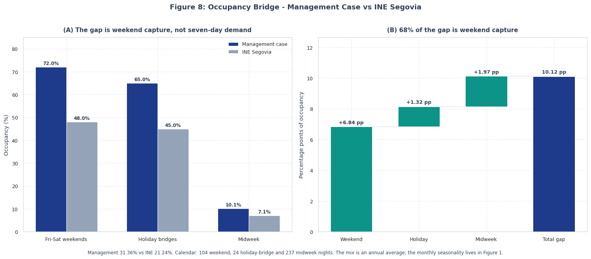

# La Dehesa del Castrillo S.L.

### Viabilidad hotelera, underwriting de deuda senior y due diligence calculada

**Un modelo financiero de nivel portfolio construido a partir de mi propio trabajo de viabilidad universitario.**
Python 3.11 · 59 tests automáticos · auditoría calculada de 16 reglas · modelo Excel de 13 pestañas · 8 figuras · pipeline de 15 pasos

[](https://github.com/magnumjpg/la-dehesa-financial-due-diligence/actions/workflows/tests.yml)


---

## La versión de 60 segundos

**El activo.** Una finca rural de 25 hectáreas en Segovia: 7 habitaciones dobles, una casa rural completa, un restaurante de 21 cubiertos y una biopiscina natural. Empezó como mi trabajo de viabilidad universitario.

**Qué construí.** Tres casos as-is (promotor, mercado INE, gestión), el stack completo de costes, fuentes y usos, una facilidad amortizable a 20 años, una auditoría calculada de 16 reglas, un Excel con fórmulas vivas, 59 tests y ocho figuras.

**La respuesta es no.** El caso de gestión incumple el covenant de 1,25x en el Año 2 con **1,15x**, necesita un **49,6% de equity en caja** en lugar del 30% previsto y devuelve una TIR de proyecto de **-9,49%** incluso con una salida al 8,5%. La recomendación de crédito es **DECLINE AS STRUCTURED (RESIZE REQUIRED)**.

**La pregunta de la ocupación es justa, y el modelo la responde.** El 31,36% no es un +48% plano sobre el 21,24% del INE. Es una mezcla ponderada al fin de semana: **72% fines de semana, 65% puentes y 10,1% entre semana**. El 68% de los 10,1 pp de gap es captura de fin de semana; el entre semana es fino tanto en el plan como en el mercado. Eso hace el caso defendible para un boutique con restaurante, no seguro.

**La reforma arregla el crédito, no el valor.** Seis cubiertos externos de F&B al día, un +5% de ADR y un FTE adicional elevan el DSCR mínimo a **2,13x**, pero el activo vale 839.075 € brutos y **813.903 € netos de un 3% de costes de salida**, frente a 1.138.625 € de inversión total: un **gap neto de -324.723 €**. Solo el rincón agresivo y no probado R4 supera el WACC del 8%, y aun así falla el test bancario neto.

**Qué me haría cambiar de opinión.** Un test de demanda de Fase 0 (pop-up o restaurante arrendado), un alcance lean de 846k € o menos, y deuda dimensionada al límite del DSCR en lugar del 35% de LTV.

---

## Cómo leer esto

| Tiempo | Lee | Qué obtienes |
|---|---|---|
| **5 min** | [La versión de 60 segundos](#la-versión-de-60-segundos) + [Sección 3](#3-los-hallazgos-que-importan) | El veredicto y los once hallazgos que lo sostienen |
| **15 min** | Añade [Sección 6](#6-calibración-de-la-demanda-ine-promotor-y-gestión) y [Sección 13](#13-reforma--resize-qué-tendría-que-ser-cierto) | Por qué el 31,36% es defendible y por qué la reforma falla igualmente |
| **30 min** | Añade [Sección 9](#9-retornos-la-salida-no-rescata-los-casos-realistas) y [Sección 14](#14-red-team-diez-ataques-a-mi-propio-modelo) | Los retornos, el test neto de salida y mis propios diez ataques al modelo |
| **Completo** | Las 20 secciones + el Excel | El rastro de auditoría completo, fórmulas y limitaciones |

> **La versión de un párrafo.** El modelo realista llega a una conclusión más dura que el trabajo universitario original. Una vez modelados el coste completo, los intereses de construcción, la amortización de la deuda, el OPEX, la reserva de FF&E y el equity plug, el caso de gestión incumple el covenant, el caso de mercado nunca cubre su servicio de deuda y ninguno gana su coste de capital. La auditoría se deja fallar a propósito: **pasan 10 de 16 reglas, quedan 5 excepciones materiales y 1 warning**, veredicto `CONDITIONAL - 5 MATERIAL EXCEPTION(S)`. Una capa separada de reforma también puede decir que no, y lo dice: arregla el covenant pero no el gap de valor.

---

## 1. Qué es este proyecto

Partí de mi propio trabajo de viabilidad universitario para una finca rural de 25 hectáreas en Segovia (7 habitaciones dobles, una casa rural completa, un restaurante de 21 cubiertos y una biopiscina natural). El Excel original es un simulador de promotor de una sola hoja con fórmulas vivas; usa una ocupación del 19,2%. La memoria Word documenta una ocupación más conservadora del 16,5-17%, contratos a tiempo parcial y una solicitud de subvención LEADER. Esa brecha entre la Word y el Excel es lo primero que tuvo que reconciliar la auditoría.

Después reconstruí el análisis en Python para responder a las preguntas que el trabajo original no podía responder:

- ¿Qué ocurre con la **ocupación oficial del INE** en lugar del supuesto del promotor?
- ¿Cuál es el **coste real all-in** de una reforma de 550 m², cocina, FF&E, biopiscina e infraestructura digital?
- ¿Se **financia el proyecto en el cierre** cuando se incluyen los intereses de construcción, los costes de preapertura, el capital circulante y una reserva de servicio de deuda?
- ¿Cuánto **equity** hace falta de verdad, y es el 30% del plan de negocio?
- ¿**Sirve la deuda** con una facilidad amortizable a 20 años, y en qué año se rompe el covenant?
- ¿El **puente de IVA** crea caja o solo la mueve?
- ¿Puede la **Fase II** autofinanciarse con la caja de la Fase I, o es un doble cómputo de la subvención y del reembolso del IVA?
- ¿Cómo son los **retornos** con y sin salida?

La capa Python no es un lavado de cara. Añade una arquitectura de tres casos, un motor de fuentes y usos, una auditoría calculada, un libro Excel vivo con fórmulas y una batería de tests que fija las cifras honestas.

---

## 2. Tres casos, lado a lado

| Caso | Ocupación (Año 1 → madurez) | Ingresos A1 | EBITDA A1 | CFADS A1 | DSCR A1 | DSCR mínimo | Caja A1 | TIR proyecto (salida 8,5%) | TIR equity (salida 8,5%) |
|---|---:|---:|---:|---:|---:|---:|---:|---:|---:|
| **Gestión (upside)** | 28,23% → 31,36% | 154.548 € | 24.280 € | 19.643 € | 1,34x | **1,15x** | 20.701 € | -9,49% | -23,16% |
| **Mercado INE** | 21,24% → 32,00% | 95.555 € | -18.566 € | -21.432 € | -1,46x | **-1,46x** | 15.000 € | -15,18% | -50,22% |
| **Promotor (Excel original)** | 19,20% → 28,92% | 86.275 € | 11.297 € | 11.297 € | 0,33x | **0,33x** | -8.039 € | 6,84% | 12,12% |

**Qué es cada caso:**

- **Promotor**: réplica fiel del Excel universitario original: 19,2% de ocupación en el Año 1 (491 noches de habitación + 72 de casa), ADR de 85 € en habitación, 380 € en casa, ticket de restaurante de 20 €, 859 comidas, deuda al 4,5% a 25 años, sin carencia, sin subvención y con el terreno comprado en lugar de aportado en especie. El modelo Python reproduce los ingresos y el EBITDA originales al euro. Es el caso que el autor suscribió realmente, y el único con TIR de equity positiva en la salida, pero tiene caja negativa en los Años 1-2.
- **Mercado INE**: el ancla de demanda independiente: 21,24% de ocupación oficial de Segovia en 2025 (INE EOTR, tabla 2070) en el Año 1, con la economía unitaria original y la rampa original de volumen del 25%/20%, que llega al 32,0% en el Año 3 y después crece un 5% anual. El attachment de F&B se mantiene en las 950 comidas originales a 20 €. Es lo más parecido a un caso "de mercado" en el libro.
- **Gestión (upside)**: 31,36% de ocupación en madurez (1,48x la media del INE), una comida en el establecimiento por huésped y día a un ticket de 25 €, el stack variable completo y un puente de IVA al 5,5%. Es un upside operativo, no un caso base. Su "upside" está en el ingreso por día ocupado (attachment de F&B), no en la ocupación: el caso de mercado llega de hecho a una ocupación madura parecida a través de la rampa original.

Los tres casos comparten el mismo CapEx (salvo la base original de 725.000 € del promotor), el mismo tipo impositivo y la misma mecánica de balance. La diferencia es la demanda, la economía unitaria y la financiación, que es exactamente donde está el riesgo.

---

## 3. Los hallazgos que importan

1. **El coste real es de 1.050.100 €, no de 725.000 €.** Terreno 250.000 €, 550 m² de obra estructural a 1.000 €/m² (550.000 €), cocina comercial 55.000 €, FF&E 65.000 €, biopiscina y paisajismo 40.000 €, digital 12.000 €, honorarios 42.600 € y contingencia del 5% 35.500 €. El presupuesto original omitía la cocina, el FF&E, los honorarios y la contingencia, y cubría solo 475.000 € de los 800.100 € de presupuesto no terrenal.
2. **El equity necesario es el 49,6% del CapEx, no el 30%.** Las fuentes y los usos solo cuadran con un equity plug en caja de **521.090,22 €**, más los 250.000 € de terreno aportados en especie. El equity total en el cierre es de **771.090,22 €**.
3. **El covenant se rompe en el Año 2, no en el Año 1.** El Año 1 es solo intereses (DSCR 1,34x). El primer año amortizante genera 27.647,64 € de servicio de deuda frente a 31.889,98 € de CFADS: **1,15x frente a un covenant de 1,25x**. No se recupera en cinco años.
4. **El caso de gestión está 0,69 puntos porcentuales por debajo de su propio break-even de covenant.** El break-even de 1,25x es una ocupación madura del **32,05%**; el plan asume el **31,36%**. El break-even operativo es del 22,26%, pero el de servicio de deuda ya es del 30,28%.
5. **El caso de mercado nunca supera 1,00x en cinco años.** Con la ocupación oficial del INE y la economía unitaria original, el EBITDA del Año 1 es **-18.566 €**, el DSCR es **-1,46x** y el mejor año solo llega a **0,86x**. Solo está financiado porque el equity plug absorbe un colchón operativo de 35.375 €.
6. **Los retornos son negativos en los dos casos realistas, incluso con salida.** La TIR de proyecto con salida a un cap rate del 8,5% es **-9,49%** (gestión) y **-15,18%** (mercado). El caso promotor supera la salida con un 6,84% de proyecto y un 12,12% de equity, pero solo después de dos años de caja negativa y con un gap de liquidez de 20.000 € en el cierre.
7. **El "funding gap" de 70,8k del README anterior ha desaparecido, y eso no es una buena noticia.** Lo ha sustituido un equity plug de 521k. Las fuentes igualan a los usos por construcción, pero el promotor tiene que aportar el 49,6% del CapEx en caja. El caso promotor conserva su línea original de 20.000 € y su gap de liquidez.
8. **El puente de IVA es una fuente de financiación, no creación de valor.** El IVA soportado del CapEx es de 168.021 € (21% sobre la base no terrenal de 800.100 €). Se dispone bajo un puente separado de 175.000 €, se repaga con la devolución de la AEAT en el Mes 18 y devenga intereses. El IVA operativo es pass-through.
9. **La Fase II no se autofinancia.** La Fase II necesita 435.564 € (359.970 € de CapEx neto + 75.593,70 € de IVA). La caja de la Fase I al final del Año 2 es de 183.322,64 €, así que el gap del phase gate es **-252.241,06 €** y el gate devuelve `DO NOT PROCEED`. Tampoco cumple la condición de DSCR (1,15x < 1,25x).
10. **La auditoría se calcula y falla.** Pasan 10 de 16 reglas. Las cinco excepciones materiales son el DSCR de gestión, la autofinanciación de la Fase II, los retornos frente al WACC, el DSCR de mercado y el requisito de equity. El warning es la ocupación de gestión frente al INE. Ese es el sentido de la capa de auditoría: informa de lo que el modelo hace realmente, no de lo que la narrativa quiere.
11. **La reforma arregla el covenant, no el gap de valor.** Una reforma realista de ingresos (R2: seis cubiertos externos al día, +5% de ADR, experiencias y 5.000 € de ahorros, un FTE adicional) eleva el EBITDA maduro de 37.042 € a 71.321 € y el DSCR mínimo de 1,15x a 2,13x. El activo vale entonces 839.075 € brutos, **813.903 € después de un 3% de costes de salida**, todavía **236.197 € por debajo del CapEx** y **324.723 € por debajo de la inversión total** en términos netos. El value engineering a 900k (R3) y el alcance lean de 846k (R5) reducen el gap pero siguen por debajo de un WACC del 8%. Solo el caso agresivo de ocho cubiertos y +10% de ADR (R4) produce un VAN positivo (+3.722 €), y aun así falla el test neto de inversión total con **-84.147 €**. La conclusión de la reforma es también un no, con un test de demanda condicional de Fase 0.

---

## 4. Stack de CapEx y depreciación

| Partida de CapEx | Importe | Depreciación (Ley 27/2014) |
|---|---:|---:|
| Terreno (25 ha, aportado en especie) | 250.000 € | No depreciable |
| Obra estructural (550 m² × 1.000 €/m²) | 550.000 € | 3% = 16.500 € |
| Cocina comercial | 55.000 € | 12% = 6.600 € |
| FF&E | 65.000 € | 10% = 6.500 € |
| Biopiscina y paisajismo | 40.000 € | 10% = 4.000 € |
| Infraestructura digital | 12.000 € | 25% = 3.000 € |
| Honorarios profesionales (6% de la obra) | 42.600 € | 3% = 1.278 € |
| Contingencia (5%) | 35.500 € | 3% = 1.065 € |
| **CapEx all-in** | **1.050.100 €** | **38.943 €/año** |

Los costes de preapertura de 35.000 € se capitalizan y se amortizan en cinco años (7.000 €/año), así que la D&A total es de **45.943 €/año**. El IVA soportado es de **168.021 €** (21% sobre la base no terrenal de 800.100 €). El caso promotor conserva la base original de 725.000 €, 99.750 € de IVA soportado y ninguna capitalización de preapertura, de modo que el test de réplica sigue siendo exacto.

La partida digital es de 12.000 € y no de 4.000 €: una propiedad de 550 m² con 8 llaves, restaurante y biopiscina necesita PMS, TPV, Wi-Fi, control de accesos y CCTV, no un único Kit Digital.

---

## 5. Financiación: fuentes y usos, equity plug y dimensionamiento de deuda

### Usos y fuentes en el cierre (caso de gestión)

| Usos en el cierre | Importe |
|---|---:|
| Terreno aportado en especie | 250.000,00 € |
| CapEx en caja (neto de IVA) | 800.100,00 € |
| Intereses durante la construcción (12 meses) | 14.701,40 € |
| IVA soportado (21% sobre CapEx no terrenal) | 168.021,00 € |
| Costes de preapertura | 35.000,00 € |
| Capital circulante inicial | 25.000,00 € |
| DSRA (6 meses del servicio del Año 2) | 13.823,82 € |
| **Total usos** | **1.306.646,22 €** |

| Fuentes en el cierre | Importe |
|---|---:|
| Deuda senior (35% LTV) | 367.535,00 € |
| Puente de IVA | 168.021,00 € |
| Equity en caja (plug) | 521.090,22 € |
| Terreno aportado en especie | 250.000,00 € |
| **Total fuentes** | **1.306.646,22 €** |
| Gap en el cierre | **0,00 €** |
| Subvención LEADER (Mes 14, post-cierre) | 163.000,00 € |

El equity en caja es un **plug**, calculado para que las fuentes igualen a los usos. No es un supuesto. En el caso de mercado el plug es de 556.465,05 € porque además absorbe un colchón operativo de 35.374,83 €; el equity total sube a 806.465,05 €. El caso promotor conserva el 30% de equity (217.500 €), la línea original de 20.000 € y un gap de 20.000 € en el cierre.

### Dimensionamiento de deuda: el DSCR es la restricción vinculante

| Test | Resultado |
|---|---:|
| Facilidad solicitada | 367.535,00 € (35,0% LTV) |
| Tope DSCR a 1,25x sobre el CFADS mínimo | **339.144,92 €** (32,3% LTV) |
| Exceso sobre el tope | 28.390,08 € |
| Servicio anual máximo implícito en el tope | 25.511,98 € |
| Restricción vinculante | **DSCR** |
| DSCR del Año 2 con la facilidad solicitada | **1,15x** |
| DSCR del Año 2 en el tope DSCR | 1,25x |

La facilidad al 35% LTV cumple el límite de loan-to-value pero incumple el covenant. En el caso de mercado el CFADS del Año 1 es negativo, así que el tope DSCR es 0 € y el motor de dimensionamiento devuelve `NONE (negative CFADS)`: ningún importe de deuda senior puede cumplir un test de 1,25x.

La deuda es una amortización francesa a 20 años al 4,0% fijo, con 12 meses de construcción (intereses capitalizados como IDC) y 12 meses de carencia de solo intereses. La anualidad se calcula sobre los 228 meses restantes: **2.303,97 €/mes**, o **27.647,64 €/año** desde el Año 2. El Año 1 solo paga intereses (14.701,44 €). El préstamo amortiza por completo en el Mes 240.

### DSRA y liquidez mensual

La DSRA contractual es de seis meses del servicio anual máximo: **13.823,82 €**. El déficit CVaR 99% de la cópula Clayton es de **62.786,01 €**, así que la reserva testeada contra la cola equivaldría a 2,27 años de servicio de deuda. No es una diferencia de redondeo: es otra señal de que la facilidad está sobreapalancada.

El motor mensual (24 meses, ingresos estacionales, servicio de deuda mensual, revólver) sitúa el valle en **abril (Mes 4)**: la caja baja a **12.004,01 €** antes de un draw de **2.995,99 €** sobre el revólver de 175.000 €, repagado en el Mes 7. El Año 1 cierra en **20.700,88 €** y el Año 2 en **183.322,64 €**. El mínimo de 15.000 € nunca se incumple y la diferencia de reconciliación mensual-anual es de **0,00 €**. La subvención LEADER llega en el Mes 14 (163.000 €) y la devolución de IVA de la AEAT en el Mes 18 (168.021 €), que repaga el puente.

---

## 6. Calibración de la demanda: INE, promotor y gestión

La *Encuesta de Ocupación en Alojamientos de Turismo Rural* (EOTR) del INE, tabla 2070 para Segovia, publica:

| Periodo | Ocupación de habitaciones |
|---|---:|
| 2023 | 21,32% |
| 2024 | 21,50% |
| 2025 | **21,24%** (77,5 días ocupados) |
| Agosto 2025 | 36,78% |
| Enero 2025 | 9,58% |

La serie mensual está calibrada a la media anual de 2025 del 21,24%, preservando los anclajes de enero y agosto. La Figura 1 compara la curva del INE con el objetivo de gestión. El caso de gestión corre el Año 1 al 0,90x de la curva madura (28,23% ponderado) y llega al 31,36% desde el Año 2; no asume crecimiento nominal del ADR tras la estabilización. Los casos de mercado y promotor conservan la rampa original de volumen del 25%/20% y el crecimiento anual del 5% desde el Año 4.

La brecha entre 19,2%, 21,24% y 31,36% es el riesgo comercial que el modelo suscribe. El caso de gestión es 1,48x la media provincial, y la auditoría lo marca como warning.

### 6.1 El puente de ocupación: 31,36% no es un +48% plano

La objeción justa es esta: si la media del INE es 21,24%, ¿cómo puede el caso de gestión asumir 31,36% sin suponer que todas las noches venden un 48% mejor? No lo hace. La media anual es la suma de tres segmentos muy distintos, y el caso de gestión es una historia de captura de fin de semana, no de demanda de siete días.

| Segmento | Noches/año | Gestión | INE Segovia | Gap (pp) | Peso del gap |
|---|---:|---:|---:|---:|---:|
| Viernes-sábado | 104 | 72,0% | 48,0% | +6,84 | 68% |
| Puentes festivos | 24 | 65,0% | 45,0% | +1,32 | 13% |
| Entre semana | 237 | 10,1% | 7,1% | +1,97 | 19% |
| **Media anual** | **365** | **31,36%** | **21,24%** | **+10,12** | **100%** |

Las ocupaciones de fin de semana y puentes son anclajes de juicio. El entre semana es el residuo que hace que los tres segmentos cuadren con el 31,36% que el modelo ya usa, así que el puente no puede cambiar la P&L a escondidas. La misma aritmética se aplica a la media del INE, que también está ponderada al fin de semana: el 21,24% oficial es aproximadamente 48% fines de semana, 45% puentes y 7,1% entre semana, no un 21% plano todas las noches.



**Qué prueba y qué no prueba:**

- **Prueba que la forma es plausible.** Un boutique de destino con restaurante puede vender casi todos los fines de semana y estar vacío un martes. Es exactamente lo que hace el mercado local, solo con una captura de fin de semana más débil.
- **Aísla el riesgo.** El 68% del gap es demanda de fin de semana. El plan no apuesta por un mercado de siete días; apuesta por precio premium en fin de semana y una base pequeña entre semana.
- **Expone el agujero.** El entre semana está solo 3,0 pp por encima del INE. Los cubiertos externos de F&B de la reforma intentan llenar precisamente ese hueco, y por eso el test de demanda de Fase 0 es la condición de avance.
- **No hace el caso seguro.** El 72% de fin de semana sigue siendo 1,5x el 48% del mercado. Los anclajes son juicio, no una curva de reservas, y el primer año es deliberadamente más débil: al 0,90x de la curva madura la mezcla es 64,8% / 58,5% / 9,1%, que da 28,23%. Ese es el "los primeros años son duros" y ya está en el modelo.

El puente se calcula en `src/core/demand_bridge.py` y queda fijado por `tests/test_demand_bridge.py`. Es una reconciliación anual, no un modelo mensual; la estacionalidad mensual vive en `src/config/ine_weights.py` y en la Figura 1.

---

## 7. Economía unitaria y break-evens

| Métrica | Valor |
|---|---:|
| Capacidad | 8 llaves (7 habitaciones dobles + 1 casa rural) = 2.920 llaves-noche/año |
| Ingreso diario bruto al 100% de ocupación | 1.500 € (975 € alojamiento + 525 € F&B) |
| Coste variable por día ocupado | 385,25 € (25,68%) |
| - COGS de F&B (30%) | 157,50 € |
| - Comisiones OTA (60% al 15%) | 87,75 € |
| - Amenities y suministros | 35,00 € |
| - Desayuno (21 huéspedes a 5 €) | 105,00 € |
| Margen de contribución antes de FF&E | 1.114,75 € (74,32%) |
| Reserva de FF&E (3% de ingresos) | 45,00 € |
| Margen de caja después de FF&E | 1.069,75 € (71,32%) |
| Overhead fijo anual | 90.575 € (personal 60.075 € + OPEX 30.500 €) |
| Servicio de deuda anual máximo (Año 2+) | 27.647,64 € |
| Carga fija total anual | 118.222,64 € |

**Break-evens por caso** (resueltos sobre el modelo completo con la rampa de cada caso; el año vinculante es el Año 2 en gestión y el Año 1 en mercado y promotor):

| Caso | Operativo (EBITDA = 0) | Servicio de deuda (DSCR 1,00x) | Covenant (DSCR 1,25x) | ADR para 1,25x con la ocupación base | ADR para TIR equity del 10% |
|---|---:|---:|---:|---:|---:|
| Gestión | 22,26% (81,2 días) | 30,28% (110,5 días) | **32,05%** (117,0 días) | 86,64 € | 116,36 € |
| Mercado | 26,83% | 48,73% | **50,43%** | 127,25 € | 128,04 € |
| Promotor | 16,76% | 36,48% | **39,32%** | 115,56 € | 83,60 € |

El caso de gestión está por encima de sus break-evens operativo y de servicio de deuda, pero **por debajo del break-even de covenant en 0,69 puntos porcentuales**. El caso de mercado necesita una ocupación madura de aproximadamente el 50% para superar 1,25x, más del doble de la media del INE. El caso promotor solo supera 1,25x desde el Año 3, y su DSCR mínimo (Año 1) es de 0,33x.

Los "días" de la economía unitaria son días ocupados de toda la propiedad (un día con las 8 llaves vendidas), por eso una ocupación del 22,26% equivale a 81,2 días.

---

## 8. Personal: tiempo parcial, no 3 FTE

La memoria Word original documenta contratos a tiempo parcial: unas 1.900 horas entre dos cocineros y 1.792 horas de limpieza. El modelo refinado utiliza por tanto:

| Puesto | Horas anuales | FTE | Bruto por hora | SMI 2026 | Convenio Segovia | ¿Cumple? |
|---|---:|---:|---:|---:|---:|---|
| Cocinero 1 | 950 | 0,54 | 14,21 € | 9,69 € | 10,12 € | Sí |
| Cocinero 2 | 950 | 0,54 | 14,21 € | 9,69 € | 10,12 € | Sí |
| Limpieza / auxiliar | 1.792 | 1,01 | 9,77 € | 9,69 € | 9,02 € | Sí |
| **Total** | **3.692** | **2,09** | - | - | - | - |

El SMI 2026 es de 17.094 € brutos anuales (14 pagas de 1.221 €, Real Decreto 126/2026). El convenio de hostelería de Segovia (2026) fija la referencia del cocinero en 17.844,16 € y la del auxiliar en 15.916,22 €; divididas por las horas anuales correspondientes, las bases horarias son 10,12 € y 9,02 €. Las tarifas horarias a tiempo parcial del modelo están por encima de ambas, y la auditoría comprueba la tarifa mínima (9,77 €) contra la base del convenio (9,02 €) y el SMI (9,69 €).

Los 58.740 € del Excel original son nómina bruta (35.640 € de cocineros + 23.100 € de limpieza). Los 60.075 € del modelo refinado incluyen la Seguridad Social a cargo de la empresa y la estructura de horas a tiempo parcial. La diferencia no es un error de nómina; es una base de coste distinta.

---

## 9. Retornos: la salida no rescata los casos realistas

| Caso | TIR proyecto (sin salida) | TIR proyecto (salida 8,5%) | TIR equity (salida 8,5%) | Valor terminal | MOIC proyecto | MOIC equity |
|---|---:|---:|---:|---:|---:|---:|
| Gestión | -35,43% | **-9,49%** | **-23,16%** | 435.783 € | 0,67x | 0,38x |
| Mercado | -40,50% | -15,18% | -50,22% | 335.419 € | 0,50x | 0,10x |
| Promotor | -29,48% | 6,84% | 12,12% | 796.462 € | 1,36x | 1,81x |

El valor terminal es el EBITDA del Año 5 capitalizado a un cap rate del 8,5%. Sin salida, el flujo de caja operativo de cinco años no recupera el CapEx en ningún caso. El VAN de proyecto de gestión a un WACC del 8% es **-574.465 €** y el VAN de equity es **-541.676 €**. El caso promotor es el único con retorno positivo en la salida, y aun así produce una TIR de proyecto del 6,84%, por debajo del coste de capital del 8%.

La razón es estructural: con un ADR de 85 € y una ocupación del 31,36%, el activo genera 37.042 € de EBITDA maduro frente a 45.943 € de D&A y 27.648 € de servicio de deuda. El negocio está cerca del break-even de caja, pero no de un retorno adecuado sobre 1,05 M€ de CapEx.

**Una advertencia sobre esta tabla:** estas TIR son brutas de costes de venta. Una salida por cap rate asume que el activo cambia de manos gratis, lo que favorece a todos los casos. La capa de reforma incorpora el test neto explícito (3% del valor, 4% en el downside combinado) y la misma lógica es la forma honesta de leer las cifras as-is: son un límite superior, no un importe neto de venta.

---

## 10. Stress-testing de escenarios

| Métrica | Conservador A1 | Conservador A3 | Base A1 | Base A3 | Optimista A1 | Optimista A3 |
|---|---:|---:|---:|---:|---:|---:|
| Ingresos | 124.798 € | 138.664 € | 154.548 € | 171.720 € | 204.003 € | 226.670 € |
| EBITDA | -7.500 € | 2.737 € | 24.280 € | 37.042 € | 64.576 € | 81.614 € |
| Beneficio neto | -82.899 € | -62.502 € | -45.606 € | -22.826 € | -3.472 € | 17.641 € |
| Caja final | 15.000 € | 108.092 € | 20.701 € | 187.565 € | 61.351 € | 306.722 € |
| DSCR | -0,56x | -0,05x | 1,34x | 1,15x | 4,54x | 2,60x |
| ICR | -0,37x | 0,14x | 1,65x | 2,66x | 5,02x | 6,72x |

El caso conservador (85% de ocupación, 95% de ADR, 110% de OPEX, +150 pb) rompe el covenant desde el Año 1 y no se recupera. El caso base es el upside de gestión. El caso optimista es una sensibilidad, no una previsión.

---

## 11. Monte Carlo y riesgo de cola con cópulas

**Monte Carlo gaussiano naïve (N = 1.000, DSCR mínimo de los Años 1-3):**

| Métrica | Valor |
|---|---:|
| DSCR mínimo medio | 1,01x |
| DSCR mínimo mediano | 1,08x |
| VaR 95% (percentil 5) | -0,29x |
| P(ruptura de covenant, DSCR < 1,25x) | 60,9% |
| P(insolvencia, DSCR < 1,00x) | 44,2% |
| Caja final media del Año 1 | 19.493 € |
| Caja final P5 del Año 1 | -5.335 € |

**Cópula multivariante (50.000 simulaciones, DSCR del Año 2):**

| Modelo | Media | Mediana | VaR 95% | VaR 99% | CVaR 99% | P(< 1,25x) | P(< 1,00x) | Déficit CVaR 99% |
|---|---:|---:|---:|---:|---:|---:|---:|---:|
| Gaussiana | 1,20x | 1,15x | -0,12x | -0,51x | -0,67x | 54,41% | 43,32% | 48.508 € |
| Student-t (ν = 4) | 1,19x | 1,15x | -0,11x | -0,54x | -0,76x | 54,59% | 43,19% | 51.350 € |
| Clayton (θ = 1,8) | 1,22x | 1,23x | -0,32x | -0,78x | **-0,95x** | 50,71% | 41,07% | **62.786 €** |

El test de crédito se ejecuta sobre el CFADS después de la reserva de FF&E y del impuesto, con la deuda contractual a 20 años y 4,0%, la carencia de 12 meses y el stack de costes completo. La cópula Clayton captura la dependencia asimétrica de la cola inferior: en un mal año, la ocupación, el ADR y el gasto en restaurante se deterioran a la vez. La DSRA recomendada es de **62.786,01 €**, que cubre el déficit CVaR 99% de Clayton y equivale a 4,54x la reserva contractual de seis meses.

---

## 12. Fase II: suites paisajísticas y estanque biológico

La Fase II añade dos suites paisajísticas de 55 m² y un estanque biológico de 200 m³. El CapEx all-in es de 359.970 € netos, más 75.593,70 € de IVA soportado, para una necesidad de caja de **435.563,70 €**.

| Componente de CapEx | Importe |
|---|---:|
| Ejecución de obra (PEM) | 260.000,00 € |
| Ejecución con honorarios e impuestos (PEC) | 309.400,00 € |
| Honorarios de ingeniería y arquitectura | 23.400,00 € |
| Impuestos municipales (ICIO) | 11.700,00 € |
| Reserva de contingencia | 15.470,00 € |
| **CapEx all-in (neto)** | **359.970,00 €** |
| IVA soportado (21%) | 75.593,70 € |
| **Necesidad de caja** | **435.563,70 €** |

**Escenarios operativos (Año 3 estabilizado, todos con 1 FTE incremental):**

| Escenario | Ocupación | ADR | EBITDA | TIR con salida 8,5% |
|---|---:|---:|---:|---:|
| Base | 35,0% | 290 € | 37.414 € | 11,42% |
| Realista | 30,0% | 270 € | 20.157 € | -2,75% |
| Stress (INE oficial) | 21,24% | 240 € | -4.394 € | n.m. |

Incluso el caso base es exigente: un 35% de ocupación para dos suites es 1,65x la media provincial del INE. El caso realista destruye capital (MOIC 0,88x) y el de stress tiene un valor de salida negativo. El schedule a 5 años rampa al 75% / 90% / 100% y después indexa al 2%.

**Phase gate:**

| Test | Valor |
|---|---:|
| DSCR de la Fase I en el Año 3 | 1,15x (suelo 1,25x) -> FAIL |
| Caja de la Fase I al final del Año 2 | 183.322,64 € |
| Necesidad de caja de la Fase II | 435.563,70 € |
| Gap de financiación de la Fase II | **-252.241,06 €** |
| Recomendación del gate | **DO NOT PROCEED** |

Si la Fase II se financiara (cosa que el gate dice que no), los ingresos consolidados del Año 3 serían **253.188 €**, el EBITDA **57.198 €**, el CFADS **49.428 €** y el DSCR **1,79x** sobre la deuda senior existente, con una valoración consolidada de **672.922 €**. Es un upside real, pero condicionado a financiación nueva, no automático.

---

## 13. Reforma / resize: ¿qué tendría que ser cierto?

Es una capa separada, no un cuarto caso as-is. Las tres proyecciones originales quedan intactas. La reforma vuelve a ejecutar el mismo motor de tres estados con `case="reform"`, un presupuesto de CapEx especificado aparte, un overlay de ingresos de F&B externo y experiencias, un FTE incremental explícito y una subvención LEADER que puede retrasarse.

La pregunta se deja responder con un "no": una reforma que arregla el covenant pero no el gap de valor sigue siendo un decline.

| Ref | Caso de reforma | CapEx | Inversión total | EBITDA A5 | DSCR mínimo | EV neto de salida | Gap neto vs inv. total | VAN proyecto | TIR proyecto |
|---|---|---:|---:|---:|---:|---:|---:|---:|---:|
| R1 | Solo capital (900k €) | 901.800 € | 986.297 € | 37.042 € | 1,34x | 422.710 € | -563.587 € | -450.359 € | -7,18% |
| R2 | Reforma de ingresos (1,05M €) | 1.050.100 € | 1.138.625 € | 71.321 € | 2,13x | 813.903 € | -324.723 € | -220.685 € | 2,53% |
| R3 | Ingresos + value engineering (900k €) | 901.800 € | 986.297 € | 71.321 € | 2,44x | 813.903 € | -172.394 € | -96.378 € | 5,37% |
| R4 | Demanda agresiva (1,05M €) | 1.050.100 € | 1.138.625 € | 92.403 € | 2,72x | 1.054.479 € | -84.147 € | +3.722 € | 8,08% |
| R5 | Alcance lean (846k €) | 846.300 € | 929.289 € | 71.321 € | 2,57x | 813.903 € | -115.387 € | -49.106 € | 6,61% |
| R6 | Downside combinado | 965.560 € | 1.051.789 € | -33.887 € | -3,82x | 0 € | -1.051.789 € | -1.021.973 € | n/a |

**Qué dice la tabla:**

- **R1 demuestra que el capital solo no funciona.** Bajar el presupuesto a 900k sin palanca de demanda deja el EBITDA en los 37.042 € as-is y destruye 563.587 € de valor frente a la inversión total, neto de costes de salida.
- **R2 arregla el problema de crédito.** Seis cubiertos externos al día a un ticket de 28 € (61.320 € de ingresos externos de F&B en madurez), 12.000 € de experiencias, un +5% de ADR y 5.000 € de ahorros elevan el EBITDA a 71.321 €. El DSCR mínimo sube de 1,15x a 2,13x, así que el covenant deja de ser la restricción vinculante.
- **Pero R2 no arregla el problema de valor.** A un cap rate del 8,5% el activo vale 839.075 € brutos y 813.903 € netos de un 3% de costes de salida. Eso es 236.197 € por debajo del CapEx de 1.050.100 € y 324.723 € por debajo de la inversión total de 1.138.625 € (CapEx + IDC + preapertura + capital circulante + DSRA). La reforma mueve el proyecto de una ruptura de covenant a un activo con VAN negativo.
- **El value engineering ayuda pero no cierra el gap.** R3 (900k) y R5 (846k) reducen el gap neto frente a la inversión total a -172.394 € y -115.387 €, con TIR de proyecto del 5,37% y 6,61%: todavía por debajo del WACC del 8%.
- **Solo el rincón de demanda agresiva supera el 8%, y no es bankable.** R4 necesita ocho cubiertos externos al día y un +10% de ADR. Produce 3.722 € de VAN y un gap bruto positivo frente al CapEx, pero el gap neto frente a la inversión total sigue siendo -84.147 € y el supuesto de demanda está muy por encima de un caso base defendible.
- **R6 confirma lo rápido que se rompe la reforma.** Ahora está anclado de verdad a la ocupación INE del 21,24% (no al anclaje de gestión) y combina la mitad de los cubiertos externos, un -10% de precio, 1,5 FTE, un sobrecoste de CapEx del 20%, cap rate de salida del 10%, +200 pb de tipos y un año de retraso de la subvención. El EBITDA se vuelve negativo (-33.887 €), el DSCR es -3,82x y el activo vale cero a efectos de cap rate. El downside se lleva en los flujos: un **VAN de -1.021.973 €**.

**Value bridge de R2 (año maduro, cap rate 8,5%):**

| Componente | Impacto en EBITDA | Impacto en EV |
|---|---:|---:|
| EBITDA base de gestión | 37.042 € | 435.783 € |
| + Subida de ADR (5%) | 7.182 € | 84.496 € |
| + F&B externo (6 cubiertos/día) | 13.698 € | 161.148 € |
| + Experiencias | 8.400 € | 98.824 € |
| + Ahorros de coste | 5.000 € | 58.824 € |
| **EBITDA y EV de la reforma** | **71.321 €** | **839.075 €** |

El bridge se calcula con el propio motor, palanca a palanca, así que cuadra con la P&L de la reforma con residuo cero. No es un waterfall escrito a mano.

La Figura 7 representa el bridge y la frontera de valor: el heat map muestra EV menos inversión total según CapEx y cubiertos externos. Casi todo el presupuesto actual destruye valor. El único rincón positivo está en torno a 700k € de CapEx (450k € de gasto no terrenal) con seis o más cubiertos. Eso no es la reforma de ocho habitaciones que se especifica hoy; es un proyecto más pequeño con otro alcance.

### 13.1 Costes de salida: el cap rate bruto favorece a todos los casos

Una salida por cap rate asume que el activo cambia de manos gratis. No es así: los costes de venta, los impuestos de transmisión y los honorarios legales son reales. La reforma carga un **3% del valor** (4% en R6) y muestra los ingresos netos junto al valor bruto.

| Caso | EV bruto | Costes de salida | EV neto | Gap neto vs CapEx | Gap neto vs inv. total |
|---|---:|---:|---:|---:|---:|
| R2 Reforma de ingresos | 839.075 € | -25.172 € | 813.903 € | -236.197 € | **-324.723 €** |
| R3 Value engineering | 839.075 € | -25.172 € | 813.903 € | -62.725 € | -172.394 € |
| R5 Alcance lean | 839.075 € | -25.172 € | 813.903 € | -7.225 € | -115.387 € |
| R4 Demanda agresiva | 1.087.091 € | -32.613 € | 1.054.479 € | +4.379 € | **-84.147 €** |
| R6 Downside combinado | 0 € | 0 € | 0 € | -965.560 € | -1.051.789 € |

La línea importante es R4: es el único caso con gap bruto positivo frente al CapEx, y aun así falla el test bancario por 84.147 € cuando se incluyen la inversión total y los costes de salida. El test neto es el que aplicaría un prestamista; el bruto es el que hace que un mal proyecto parezca marginal.

### 13.2 Sensibilidad de tipos: el covenant aguanta +300 pb, el valor no

La reforma base está precio a un tipo fijo del 4,0%. La tabla vuelve a ejecutar R2 con +0 / +100 / +200 / +300 pb.

| Shock | Tipo de interés | DSCR mínimo | VAN proyecto | Gap neto vs inv. total |
|---|---:|---:|---:|---:|
| +0 pb | 4,00% | 2,13x | -220.685 € | -324.723 € |
| +100 pb | 5,00% | 1,96x | -221.863 € | -325.900 € |
| +200 pb | 6,00% | 1,65x | -223.094 € | -327.131 € |
| +300 pb | 7,00% | 1,41x | -224.376 € | -328.413 € |

El covenant sigue pasando a +300 pb (1,41x frente a 1,25x), así que el riesgo de tipos no es lo que mata a R2. El resultado interesante es que el **VAN unlevered apenas se mueve**: el proyecto es débil porque no gana su coste de capital a nivel operativo, no porque la deuda sea cara. Una facilidad a tipo variable con menor plazo castigaría más la TIR de equity y el cash sweep de lo que muestra esta tabla.

### 13.3 Riesgo de subvención: el LEADER es estructural

La reforma asume una subvención LEADER de 162.766 € desembolsada en el Año 2. No hay carta de concesión en el repositorio, así que el modelo prueba el downside explícitamente.

| Escenario R3 | VAN proyecto | Diferencia |
|---|---:|---:|
| Subvención en Año 2 (base) | -96.378 € | - |
| Subvención retrasada a Año 3 | -105.254 € | -8.876 € |
| **Sin subvención** | **-216.215 €** | **-119.838 €** |

Sin la subvención el proyecto pierde otros 119.838 € de valor y necesita más equity en el cierre. La subvención no es una partida de redondeo; es parte del stack de financiación y debe tratarse como condicional hasta que exista la carta de concesión.

### 13.4 Qué falsificaría la reforma

La reforma es un conjunto de supuestos, no una previsión. El [red team](#14-red-team-diez-ataques-a-mi-propio-modelo) lista los diez ataques que esperaría de un comité de crédito y cómo se responde a cada uno. Los tres que cambiarían la conclusión más rápido son: menos de cuatro cubiertos externos al día, una ocupación de fin de semana materialmente inferior al 72% y un presupuesto de obra por encima de 1,05 M€. Cualquiera de los tres mueve R2 de "negativo pero cerca" a "claramente inviable".

**Recomendación de la reforma:** `DECLINE AS STRUCTURED - ONLY THE AGGRESSIVE, UNPROVEN DEMAND CASE CLEARS THE WACC`.

La continuación honesta es un **test de demanda de Fase 0** de bajo coste: probar la demanda de F&B externo y experiencias con un pop-up o un restaurante arrendado antes de comprometer capital de construcción. Si la familia quiere avanzar, la primera fase debería limitarse al alcance lean y la segunda debería quedar detrás de un gate de demanda. El terreno debe cargarse a su valor de oportunidad en todo momento; el proyecto no se vuelve viable porque la finca ya sea propiedad de la familia.

**Siguiente capa, aún no implementada: R7 (cabañas y agroturismo).** La reforma R2-R6 arregla el crédito, no el valor. La pregunta que queda es si un producto distinto —cinco o seis cabañas de dos dormitorios más la casa principal— podría hacerlo. [BENCHMARKS_R7_ES.md](BENCHMARKS_R7_ES.md) fija la banda antes de escribir código: ADR de 180-210 €, ocupación estabilizada del 45-55%, 110-150 k€ por cabaña all-in y un cap rate de salida del 9,5%. La comprobación aritmética solo pasa en el borde bueno del corredor: seis cabañas a 110 k€, 200 € y 50% dejan +62 k€ sobre 1,53 M€ de inversión total, un 4% de margen; a 120 k€ el mismo caso falla. R7 será un preset separado detrás del mismo gate de Fase 0, no un cuarto caso as-is.

---

## 14. Red team: diez ataques a mi propio modelo

Un modelo que solo sobrevive a preguntas amables no es un modelo. Estos son los diez ataques que haría si me pagaran por romper este, y lo que el libro dice realmente. El memo largo está en [RED_TEAM_ES.md](RED_TEAM_ES.md).

**1. "El 31,36% está un 48% por encima de la media del INE. Te has inventado la demanda."**
Justo, y la auditoría dice lo mismo (la Regla 10 falla a 1,48x). El puente es la respuesta: 72% fines de semana, 65% puentes y 10,1% entre semana, con el 68% de los 10,1 pp de gap viniendo de la captura de fin de semana. Es una historia premium de fin de semana, no un mercado de siete días, y sigue siendo un caso upside. **Veredicto: debilita el caso base, pero está declarado y testado; el caso de mercado es el ancla downside.**

**2. "Tu caso de mercado llega al 32% igualmente, así que el downside no es un downside."**
Llega al 32% solo manteniendo la rampa de volumen original del promotor (25%/20%) y el crecimiento del 5% desde el Año 3. Esa rampa es un supuesto, no evidencia. Con el 21,24% oficial en el Año 1 el caso tiene EBITDA negativo (-18.566 €) y un DSCR de -1,46x; nunca supera 1,0x en cinco años. **Veredicto: la rampa es el punto débil, y está etiquetada como tal.**

**3. "Cobras 250k por un terreno que la familia ya tiene."**
Es el valor de oportunidad del solar, y es el cargo correcto. Tratar el terreno como gratis convertiría una subvención familiar en retorno del proyecto y favorecería todas las métricas. El modelo además muestra el terreno por separado para que el lector pueda quitarlo. **Veredicto: refuerza el decline; sin cambios.**

**4. "Un cap rate del 8,5% es demasiado bajo para la Segovia rural."**
De acuerdo como riesgo. El modelo usa 8,5% en la salida base y 10% en R6. Cada +100 pb quita unos 76k € de valor bruto: a un cap rate del 10%, R2 vale 713k € y el gap neto frente a la inversión total se amplía a -447k €. **Veredicto: refuerza el decline.**

**5. "Seis cubiertos externos de F&B al día es inventado."**
Sí. Es el supuesto no probado más importante de la reforma, y no hay competitive set, ingeniería de menú ni build-up de cubiertos por franja en el repositorio. R6 lo baja a tres y el caso colapsa a EBITDA negativo. **Veredicto: debilidad real; es exactamente por lo que la recomendación es un test de demanda de Fase 0, no un presupuesto de construcción.**

**6. "Un FTE no puede con seis cubiertos y los desayunos."**
Plausible. La base usa un FTE a 28k € cargados; R6 usa 1,5. La base honesta probablemente debería ser 1,25-1,5 FTE, lo que reduciría el EBITDA de R2 en 7k-14k € y ampliaría el gap. **Veredicto: debilidad real, ya marcada como condición para seguir.**

**7. "Tu Monte Carlo es un gaussiano naive."**
Correcto. Se mantiene como benchmark; el motor de cúpulas es la herramienta real de cola. El CVaR 99% de Clayton implica una DSRA de 62.786 € frente a la reserva contractual de 13.824 €, así que el stack de financiación está infradotado en la cola. **Veredicto: refuerza el decline.**

**8. "El VAN unlevered subestima el caso de equity; el apalancamiento puede rescatarlo."**
El apalancamiento no crea valor cuando el yield del activo está por debajo del coste de la deuda, y el covenant DSCR limita la facilidad a 339k € frente a los 367k € solicitados. La TIR de equity de R2 es 1,96%; la de R4 es 10,16%, pero solo en el rincón de demanda no probado. **Veredicto: no hay rescate.**

**9. "Duplicas la subvención e ignoras el timing del IVA."**
La subvención es una fuente de capital, no un ingreso, y el puente de IVA es una facilidad separada de 175k € que se repaga con el reembolso de la AEAT en el Mes 18, con intereses. El gate de Fase II existe precisamente para probar si la subvención y el reembolso de IVA se gastan dos veces; devuelve `DO NOT PROCEED`. **Veredicto: no hay doble cómputo; el gate es el control.**

**10. "Una salida en el Año 5 a 11,8x EBITDA domina el resultado."**
Es un test, no un rescate: sin salida la TIR de proyecto de gestión es -35,43%, y la tabla muestra ambas. El múltiplo de salida es alto para un activo rural, y por eso el cap rate se estresa al 10% en R6 y el test neto de costes se muestra por separado. **Veredicto: la salida no rescata el caso; solo hace la caída más pequeña.**

**Marcador:** seis ataques refuerzan el decline, tres exponen debilidades reales (cubiertos, FTE, cap rate de salida) que están todas condicionadas al test de Fase 0, y uno es un problema de presentación. Ninguno convierte el proyecto en una inversión viable.

---

## 15. Auditoría calculada: 16 reglas, 10 pasan, 5 materiales, 1 warning

La auditoría se calcula desde el modelo, no se escribe a mano. Se deja fallar.

| Regla | Severidad | Estado | Real | Umbral |
|---|---|---|---:|---:|
| RULE_01_BALANCE_SHEET_EQUALITY | Material | **PASS** | 0,00 € | ≤ 0,01 € |
| RULE_02_HOSPITALITY_VAT_RATE | Material | **PASS** | 10,0% | 10,0% |
| RULE_03_CAPEX_INPUT_VAT | Material | **PASS** | 168.021 € | 168.021 € |
| RULE_04_PAYROLL_HOURLY_COMPLIANCE | Material | **PASS** | 9,77 € | ≥ 9,02 € |
| RULE_05_MANAGEMENT_DSCR | Material | **FAIL** | 1,15x | ≥ 1,25x |
| RULE_06_MINIMUM_CASH | Material | **PASS** | 20.701 € | ≥ 0 € |
| RULE_07_DSRA_SIZING | Warning | **PASS** | 13.824 € | ≥ 6 meses |
| RULE_08_SOURCES_USES_CLOSE | Material | **PASS** | 0,00 € | ≥ 0 € |
| RULE_09_VAT_BRIDGE_LIMIT | Material | **PASS** | 168.021 € | ≤ 175.000 € |
| RULE_10_OCCUPANCY_VS_INE | Warning | **FAIL** | 1,48x | ≤ 1,10x |
| RULE_11_PHASE2_SELF_FUNDING | Material | **FAIL** | -252.241 € | ≥ 0 € |
| RULE_12_RETURNS_VS_WACC | Material | **FAIL** | -9,49% | ≥ 8,0% |
| RULE_13_PROMOTER_REPLICATION | Info | **PASS** | 86.275 € / 11.297 € | exacto |
| RULE_14_MARKET_DSCR | Material | **FAIL** | -1,46x | ≥ 1,25x |
| RULE_15_EQUITY_REQUIREMENT | Material | **FAIL** | 49,62% | ≤ 30,0% |
| RULE_16_FFE_RESERVE | Info | **PASS** | 4.636 € | 3% de ingresos |

**Veredicto:** `CONDITIONAL - 5 MATERIAL EXCEPTION(S)`.

Las cinco excepciones materiales son el DSCR de gestión, la autofinanciación de la Fase II, los retornos frente al WACC, el DSCR de mercado y el requisito de equity. El warning es el supuesto de ocupación de gestión (1,48x la media del INE). El JSON de auditoría se exporta a `data/model_audit_summary.json` (schema 4.0.0) y las mismas reglas se reproducen en la pestaña `Funding & Audit` del Excel.

---

## 16. El modelo Excel

El libro tiene **13 pestañas** y **2.060 fórmulas vivas**:

| Pestaña | Propósito | Fórmulas |
|---|---|---:|
| `Read Me & Checks` | Mapa del modelo, tres casos, checks de integridad y hallazgos principales. | 12 |
| `Inputs` | Todos los supuestos codificados en un solo lugar (celdas azules). | 0 |
| `Live Model` | P&L, cash flow, deuda y balance a 5 años con fórmulas; replica el caso de gestión. | 316 |
| `Funding & Audit` | Fuentes y usos, gap, consistencia de la línea de crédito, gate de la Fase II y reglas de auditoría. | 9 |
| `Executive Scorecard` | Scorecard de underwriting de una página con CFADS, FF&E y retornos. | 0 |
| `3-Statement Model` | Salida completa de Python: P&L, cash flow y balance. | 0 |
| `Debt Schedule` | Amortización francesa mensual de 240 meses más el resumen anual con SUMIF. | 1.723 |
| `Scenario Stress-Testing` | Conservador / base / optimista y la sensibilidad 2D del DSCR del Año 2. | 0 |
| `Monte Carlo Risk` | Simulación estocástica de riesgo de crédito de 1.000 iteraciones. | 0 |
| `Credit Risk & Copula` | Comparativa de cola Gaussian / Student-t / Clayton y dimensionamiento de la DSRA. | 0 |
| `Unit Economics & Runway` | RevPAR, TRevPAR, margen de contribución y stress de liquidez mensual. | 0 |
| `Phase II Expansion` | Suites y estanque: CapEx, P&L, escenarios, phase gate e impacto consolidado. | 0 |
| `Reform Case` | Presets R1-R6, value bridge de R2, salida bruta/neta, frontera CapEx/cubiertos, stress tests, sensibilidad de tipos y recomendación de reforma. | 0 |

El `Live Model` es intencionadamente simple y transparente: los ingresos son una fórmula enlazada a `Inputs`, la deuda viene de `Debt Schedule` y los checks comparan la salida viva con Python. La pestaña de deuda reproduce el `ROUND` mensual del motor Python, de modo que el servicio del Año 2 es 27.647,64 € y el préstamo cierra a cero en el Mes 240.

Las fórmulas se han validado con un motor de cálculo independiente en Python: ingresos 154.548 €, EBITDA 24.280 €, DSCR del Año 2 1,1534x, caja del Año 1 20.700,89 €, caja del Año 2 183.322,65 € y descuadre de balance 0,00 € coinciden dentro de las tolerancias de 1 € / 0,01x. La pestaña `Read Me & Checks` muestra correctamente el check del covenant como `FAIL`; la pestaña `Funding & Audit` puede mostrar `FAIL`. Eso es la auditoría funcionando como debe.

Las pestañas de informe son snapshots de Python y no recalculan. Abre el libro en Excel o LibreOffice para ver evaluar las fórmulas vivas.

---

## 17. Arquitectura del repositorio

```
proyecto-dehesa-del-castrillo/
├── main.py                       # pipeline de 15 pasos
├── README.md / README_ES.md
├── RED_TEAM.md / RED_TEAM_ES.md # diez ataques al modelo y sus respuestas
├── BENCHMARKS_R7_ES.md          # nota de evidencia para el caso R7 (cabañas + agroturismo)
├── requirements.txt
├── .github/workflows/tests.yml   # CI: tests + pipeline
├── src/
│   ├── config/
│   │   ├── assumptions.py        # CapEx, personal, deuda, opex, casos, financiación
│   │   ├── reform.py             # ReformConfig, anclaje de demanda y presets R1-R6
│   │   └── ine_weights.py        # serie mensual INE Segovia (calibrada al 21,24%)
│   ├── core/
│   │   ├── statements.py         # motor de 3 estados, tres casos, equity plug
│   │   ├── debt.py               # amortización francesa con carencia e IDC
│   │   ├── tax.py                # IVA e Impuesto de Sociedades con BIN
│   │   ├── metrics.py            # DSCR, ICR, TIR (Newton + bisección), retornos con salida
│   │   ├── funding.py            # fuentes y usos, dimensionamiento, phase gate
│   │   ├── unit_economics.py     # economía unitaria USALI y break-evens
│   │   ├── monthly_cash.py       # stress de liquidez mensual y revólver
│   │   ├── expansion.py          # CapEx, escenarios y gate de la Fase II
│   │   ├── credit_committee.py   # DSRA y memo de underwriting
│   │   ├── demand_bridge.py      # puente de ocupación gestión vs INE y descomposición del gap
│   │   ├── reform.py             # motor de reforma, value bridge, frontera, stress, JSON
│   │   └── model_audit.py        # auditoría calculada, 16 reglas, export JSON
│   ├── data/
│   │   ├── extract_raw.py        # reconciliación con el Excel original
│   │   ├── export_excel.py       # libro de 13 pestañas
│   │   └── live_excel.py         # pestañas vivas con fórmulas
│   ├── scenarios/
│   │   └── scenario_analysis.py  # conservador / base / optimista
│   ├── simulation/
│   │   ├── monte_carlo.py        # Monte Carlo gaussiano naïve
│   │   └── copula_engine.py      # Gaussian / Student-t / Clayton
│   └── visualization/
│       └── charts.py             # ocho figuras institucionales
├── tests/                        # 12 ficheros, 59 tests
├── raw_data/                     # libros fuente para la reconciliación
├── data/                         # modelo Excel, JSON de auditoría y JSON de reforma
└── assets/                       # figure_*.png
```

---

## 18. Instalación y ejecución

```bash
git clone https://github.com/magnumjpg/la-dehesa-financial-due-diligence.git
cd la-dehesa-financial-due-diligence
pip install -r requirements.txt

# Pipeline completo (15 pasos, gráficos, Excel, JSON de auditoría y de reforma)
python main.py

# Sin generación de gráficos
python main.py --no-charts

# Batería de tests (59 tests)
python -m pytest tests/ -q
```

**Salidas:**

- `data/La_Dehesa_del_Castrillo_Financial_Model.xlsx`: 13 pestañas, 2.060 fórmulas.
- `data/model_audit_summary.json`: auditoría calculada, schema 4.0.0.
- `data/reform_analysis.json`: presets R1-R6, value bridge, frontera, stress tests y recomendación.
- `assets/figure_*.png`: ocho figuras institucionales.

El pipeline es determinista por defecto; las simulaciones de Monte Carlo y cópulas usan semilla fija (42).

---

## 19. Limitaciones y próximos pasos

Esto es un modelo de portfolio, no un memorando de inversión. Las limitaciones principales son explícitas:

1. **El caso de gestión es un upside.** El 31,36% de ocupación es 1,48x la media provincial del INE, y aun así incumple el covenant de 1,25x. Nunca debería presentarse como caso base.
2. **El caso de mercado no es INE puro en madurez.** Arranca en el 21,24%, pero conserva la rampa original de volumen del 25%/20% y el crecimiento nominal del 5%, así que llega al 32% en el Año 3. El attachment de F&B se queda en las 950 comidas originales.
3. **El Monte Carlo es un gaussiano naïve.** El motor de cópulas es la mejor herramienta de riesgo de cola; la simulación gaussiana se mantiene como benchmark.
4. **La DSRA es contractual, no testeada contra la cola.** El motor de financiación usa seis meses (13.824 €); el comité de crédito recomienda 62.786 € según el CVaR 99% de Clayton. El term sheet debería usar la cifra mayor, lo que ampliaría el requisito de equity.
5. **El CapEx de la Fase II es una estimación pretender.** No hay ofertas de construcción vinculantes; la contingencia es el 5% del PEC.
6. **El modelo fiscal es simplificado.** Usa un tipo de sociedades del 25%, sin grupo de IVA, sin deducciones autonómicas y con un schedule de BIN limitado al horizonte de proyección.
7. **El modelo de personal es a tiempo parcial.** Las tarifas horarias cumplen, pero el riesgo de planificación, cobertura y rotación sigue existiendo.
8. **La subvención se asume comprometida.** No hay carta de concesión en el repositorio; el timing LEADER se modela en el Mes 14.
9. **Los dos libros fuente de la reconciliación están en `raw_data/`.** La memoria Word original y el libro vivo de OneDrive no se redistribuyen; el caso promotor está codificado a partir de los valores auditados y se replica en `statements.py`.
10. **La demanda del restaurante es solo de huéspedes en los casos as-is.** El modelo asume una comida por huésped y día en el caso de gestión (unas 2.163 comidas en el Año 1), sin cubiertos externos, eventos ni ingresos de bebidas. La capa de reforma añade cubiertos externos de forma explícita, pero esa demanda es un supuesto, no evidencia.
11. **Sin booking curve ni competitive set.** El ADR es plano en el caso de gestión; los casos de mercado y promotor usan un crecimiento nominal del 5% desde el Año 4. Un mandato real modelaría la curva de reservas y el set competitivo local.
12. **El motor mensual es un stress de liquidez, no un modelo mensual completo de tres estados.** Reconcilia con los estados anuales (diferencia 0,00 €) pero no los sustituye.
13. **La demanda de la reforma no está probada de forma independiente.** Seis cubiertos externos de F&B al día es un supuesto de restaurante de destino; no hay competitive set local, ni ingeniería de menú, ni un build-up de cubiertos por franja horaria, ni evidencia de que la finca de 25 hectáreas pueda atraer ese tráfico fuera de los fines de semana.
14. **La frontera de la reforma es un dispositivo de sensibilidad, no un presupuesto.** Escala uniformemente el presupuesto no terrenal. El rincón positivo de ~700k implica 450k € de gasto no terrenal para una reforma de ocho habitaciones, lo que exigiría un alcance materialmente menor y un cost plan de contratista.
15. **El FTE incremental es un juicio.** Un FTE para seis cubiertos externos al día es el mínimo escalón de personal; R6 prueba 1,5 FTE y aun así muestra lo rápido que se rompe la reforma.
16. **Los anclajes del puente de ocupación son juicio, no una curva de reservas.** El 72% de fin de semana y el 65% de puentes son plausibles para un boutique de destino, pero no están medidos. El reparto del INE (48% / 45%) se infiere de la media anual oficial, no lo publica el INE.
17. **Los costes de salida son un supuesto de planificación.** El 3% del valor (4% en R6) cubre costes de venta, impuestos de transmisión y honorarios; la factura real de Castilla y León podría ser mayor. El test neto es correcto en dirección, no una cotización.
18. **R6 es un downside de demanda INE real, y su EV está limitado a cero.** Un activo con pérdidas no vale una cantidad negativa, pero una liquidación real podría exigir caja de remediación. El VAN lleva las pérdidas operativas; la línea de valor no pretende ser un análisis de liquidación.
19. **La sensibilidad de tipos es una re-ejecución, no un modelo de refinanciación.** Estresa una facilidad a tipo fijo y muestra el DSCR y el VAN unlevered; no modela una senda de cupón variable, costes de ruptura ni un plazo distinto.

**Próximos pasos que daría en un mandato real:**

- Redimensionar la facilidad senior al tope DSCR (339.145 €) o reajustar el ADR para superar 1,25x con un 10% de headroom.
- Elevar el equity en caja a al menos 521.090 € y documentar la aportación del terreno.
- Estructurar el puente de IVA y el revólver como facilidades comprometidas separadas.
- Encargar ofertas de construcción vinculantes y un informe de QS para el paquete de obra de 550k € y para la Fase II.
- Testear la nómina con un escenario de personal a tiempo completo y una inflación salarial del 10%.
- Probar un sobrecoste del 20% y un retraso de 12 meses en la subvención LEADER.
- Ejecutar un test de demanda de Fase 0 de bajo coste (pop-up o restaurante arrendado) antes de comprometer capital de construcción.
- Si la familia avanza, encargar un diseño lean con QS dentro del envelope de 846k € o menos y valorar la segunda fase como una opción separada.

---

## 20. Referencias

- **INE**, *Encuesta de Ocupación en Alojamientos de Turismo Rural* (EOTR), tabla 2070, Segovia, 2023-2025.
- **Ley 37/1992**, *Impuesto sobre el Valor Añadido*, art. 91.Uno.2.2ª (tipo del 10% para hostelería) y arts. 92-114 (IVA soportado deducible).
- **Ley 27/2014**, *Impuesto sobre Sociedades*, tipo del 25% y tablas de amortización acelerada.
- **Convenio Colectivo Provincial de Hostelería de Segovia** (2026), tablas salariales de cocineros, camareros y auxiliares.
- **Real Decreto 126/2026**, SMI 2026 (17.094 € brutos/año, 14 pagas de 1.221 €).
- **LEADER / Diputación de Segovia**, marco de subvenciones de desarrollo rural (163.000 € asumidos).
- **USALI** (Uniform System of Accounts for the Lodging Industry), 11ª edición, para la estructura de economía unitaria.
- **Benchmark set:** Vivood Landscape Hotel (Alicante), Miluna Open Nature Rooms (Toledo), Basoa Suites (Navarra), Cabañitas del Bosque (A Coruña).

---

### Una nota sobre autoría y propósito

El Excel y la Word originales son mi propio trabajo universitario. La capa Python se añadió para demostrar modelización financiera asistida por IA, no para reclamar la autoría del estudio original. El valor del modelo no está en hacer que el proyecto parezca mejor; está en hacer visibles, cuantificables y testeables sus debilidades. El veredicto `CONDITIONAL` de la auditoría y la recomendación `DECLINE AS STRUCTURED` del comité de crédito son las salidas honestas.
